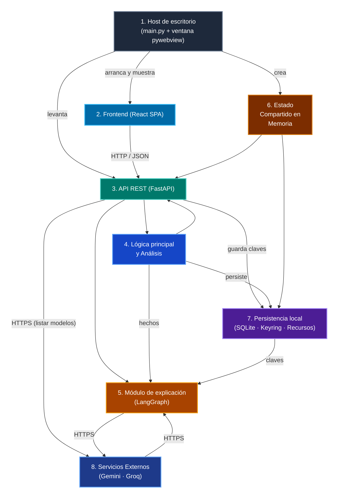

# Arquitectura de GenPath Explorer

GenPath Explorer es una aplicación de escritorio para explorar resultados de GSEA de tumores de cabeza y cuello frente a controles sanos, comparando rutas biológicas entre tipos celulares y explicándolas en lenguaje natural con un LLM. Se ejecuta como un programa normal, pero por dentro es una aplicación web local: una interfaz React que habla por HTTP con un backend Python que corre en la propia máquina del usuario.

## Diagrama

## Componentes

1. **Host de escritorio.** `main.py` es el punto de entrada y orquesta el arranque: abre la base de datos, importa los datos de muestra pendientes, crea el estado compartido, levanta el servidor local (solo en `127.0.0.1`) en un hilo secundario, espera a que responda y abre una ventana nativa (pywebview) que lo muestra. Al cerrar la ventana detiene el servidor. Así el usuario no técnico no configura nada.

2. **Frontend.** SPA en React que se sirve como ficheros estáticos desde el propio servidor. Dibuja tablas, mapa de calor y gráficos (SVG propio) y gestiona filtros e interacción. No accede a ficheros ni a la base de datos: toda comunicación con el backend es HTTP/JSON (y multipart para subir ficheros). Puede abrirse también en un navegador normal.

3. **API REST.** FastAPI, bajo el prefijo `/api`. Valida las entradas con modelos Pydantic y los endpoints tienen su propio modelo Pydantic de respuesta, lo que fija el contrato con el frontend. Traduce los errores de dominio a códigos HTTP (400, 404, 422, 500, 502). Tres familias de endpoints:
   - **Datos:** datasets, ficheros (subida, corrección de mapeo, borrado), preferencias, presets de filtros y plantilla CSV.
   - **Análisis:** vista global, comparación de pares, detalle de ruta, genes recurrentes y apariciones de un gen.
   - **Explicación:** proveedores LLM, claves API, ajustes y generación de la explicación.

   El backend no guarda estado entre peticiones: cada una lleva sus filtros.

4. **Lógica principal y Análisis.** Sin dependencias web:
   - *Ingesta y normalización:* lectura tolerante de Excel/CSV/TSV/TXT/JSON como texto, detección de columnas, tipo celular y colección, y validación de campos obligatorios (ruta, NES, métrica de significancia).
   - *Filtrado y patrones:* aplica umbrales de significancia, |NES| y sentido, y clasifica cada ruta en **mismo sentido**, **sentido opuesto**, **mixto** o **específica**.
   - *Similitud y genes:* Jaccard con signo entre tipos celulares, solapamiento de genes del *core enrichment* y genes recurrentes. Nunca recalcula p-valores ni NES.
   - *Hechos:* convierte el análisis en un JSON determinista y redondeado, que es lo único que puede usar el LLM.

5. **Módulo de explicación (LLM).** Orquestado con LangGraph. Genera la explicación a partir de los hechos, la verifica y la corrige (ver flujo 5). También gestiona los proveedores, las claves API y los ajustes de los modelos.

6. **Estado compartido en memoria.** Contenedor creado al arrancar y compartido por todas las peticiones: base de datos, anotaciones génicas (HGNC, cargadas de forma perezosa) y una caché de modelos disponibles por proveedor, que se invalida al cambiar o borrar la clave.

7. **Persistencia local.** Enfoque *local-first*:
   - **SQLite** (en el directorio de datos del usuario): datasets, ficheros con sus filas originales, rutas procesadas, preferencias (incluidos presets y ajustes de explicación) y carpetas de muestra ya importadas. El esquema está versionado con migraciones.
   - **Keyring** del sistema operativo: claves API, nunca en la base de datos ni en texto plano.
   - **Recursos empaquetados** de solo lectura: frontend, anotaciones HGNC y datos de muestra.

8. **Servicios externos.** APIs HTTPS de Google Gemini y Groq. Hoy se usan para listar los modelos disponibles y validar la clave; en el módulo de explicación, para generar y evaluar. Es la única conexión de red de la aplicación y sus fallos (red, *timeout*, clave rechazada) se aíslan y se devuelven como errores HTTP controlados.

## Conceptos clave

- **`data_version`:** contador por dataset que sube cada vez que cambian los datos del análisis (importar, corregir mapeo, cambiar tipo celular o colección, borrar). No cambia al renombrar. Todas las respuestas de análisis y explicación lo incluyen, y el frontend lo usa para marcar una interpretación como desactualizada.
- **Fichero vigente:** si hay varios ficheros del mismo tipo celular y colección, solo cuenta el más reciente sin errores.
- **Filas no significativas:** se conservan marcadas como no significativas (no se descartan), para que el frontend las muestre atenuadas. Solo el filtro por nombre elimina filas.

## Flujos principales

### 1. Arranque
1. `main.py` abre SQLite. Si la base de datos no existe o es antigua, crea o migra el esquema.
2. Busca carpetas de datos de muestra (empaquetadas y externas). Cada subcarpeta aún no registrada se lee, se normaliza (flujo 2, pasos 3–5) y se guarda como un dataset nuevo con su origen (demo o real). Se registra como importada para no repetirla, aunque el usuario borre el dataset.
3. Crea el estado compartido (base de datos, anotaciones génicas y caché de modelos) y lo asocia a la aplicación FastAPI.
4. Levanta el servidor en un hilo secundario y espera, con un tiempo máximo, a que responda. Si no arranca, aborta con error.
5. Abre la ventana nativa apuntando al servidor local, que sirve el frontend. Al cerrarla, detiene el servidor.

### 2. Importación de ficheros
1. El usuario arrastra uno o varios ficheros en la pestaña Datos. El frontend los envía en una petición multipart, con nombre y descripción opcionales del dataset (o a un dataset existente).
2. La API crea el dataset (si es nuevo) y procesa cada fichero de forma independiente.
3. **Lectura:** se lee como tabla de texto, sin interpretar números todavía, detectando el separador y la codificación. Si no se puede leer, el fichero se descarta y se informa del error.
4. **Normalización:** detecta las columnas (ruta, NES, significancia, genes…), el tipo celular (a partir del nombre) y la colección (a partir de los nombres de ruta o, si no basta, del nombre del fichero). Elige la métrica de significancia por prioridad (p ajustado, q-valor, p-valor nominal con aviso). Descarta filas incompletas y conserva la última aparición de rutas repetidas.
5. **Guardado:** las rutas procesadas y las filas originales se guardan en SQLite, incluso si hay errores de mapeo, para poder corregirlos. Cada guardado incrementa `data_version`.
6. La respuesta devuelve, por fichero, filas leídas, filas válidas, estado (correcto, aviso o error), columnas asignadas y el nuevo `data_version`. Un error en un fichero no impide cargar los demás.

### 3. Corrección de un fichero
1. En la tabla de ficheros cargados, el usuario corrige el tipo celular, la colección, el mapeo de columnas o la fuente de significancia.
2. Si cambia el mapeo o la fuente de significancia, el backend recupera las filas originales de SQLite, repite la normalización con el nuevo mapeo y reemplaza las rutas del fichero (sin pedir de nuevo el archivo). Si el usuario había fijado algún dato a mano, este se respeta.
3. Si solo cambia el tipo celular o la colección, se actualizan esos campos.
4. Se incrementa `data_version` y la respuesta devuelve el fichero actualizado con el nuevo valor, para que el frontend redibuje todas las vistas.

### 4. Análisis
1. El frontend envía, en cada petición, la colección, los tipos celulares y los filtros activos (p ajustado máximo, |NES| mínimo, sentido y texto de búsqueda).
2. La API valida los filtros con Pydantic y comprueba que el dataset existe (404) y que cada tipo celular tiene fichero en esa colección (422).
3. Se cargan solo los ficheros vigentes de esos tipos celulares y se marca cada ruta como significativa o no. Las no significativas se conservan; solo el filtro por nombre las elimina.
4. Según la vista, el dominio calcula:
   - Patrón de cada ruta significativa (mismo sentido, opuesto, mixto o específica).
   - Similitud Jaccard con signo entre cada par de tipos.
   - Genes comunes y solapamiento por pares en una ruta.
   - Genes recurrentes en las rutas significativas.
   - Apariciones de un gen concreto, con sus metadatos HGNC.
5. La respuesta usa un modelo Pydantic propio e incluye `data_version`. El frontend compara ese valor con el que tiene para saber si debe invalidar la interpretación generada.

### 5. Configuración de proveedores
1. El usuario introduce la clave API de un proveedor. La API la guarda en el keyring del sistema y vacía la caché de modelos de ese proveedor.
2. Al abrir el selector de modelos, la API consulta la caché de modelos disponibles. Si no está, lee la clave del keyring, consulta al proveedor por HTTPS y filtra los modelos de texto permitidos (Groq: lista cerrada; Gemini: modelos de texto, marcando los recomendados). Guarda el resultado en la caché.
3. Los errores se traducen: clave rechazada (400), proveedor caído o sin red (502).
4. Al guardar los ajustes (modelo generador, modelo juez, uso del juez y número de correcciones), la API comprueba que los modelos elegidos están disponibles y los guarda en SQLite.

### 6. Explicación
1. El frontend envía los filtros de comparación (mínimo 2 tipos celulares). La API carga los datos como en el flujo 4.
2. El dominio construye el JSON de **hechos**: rutas significativas con patrón, NES y significancia, similitudes, genes comunes y genes recurrentes relevantes, todo redondeado. Es lo único que verá el LLM.
3. El generador redacta la explicación solo a partir de los hechos, con los modelos y claves configurados en el flujo 5.
4. **Verificación determinista:** busca genes, rutas y cifras que no están en los hechos, y omisiones de datos relevantes.
5. **Verificación con juez** (solo cuando hay un modelo de juez seleccionado): extrae afirmaciones y evalúa fundamentación, coherencia y completitud.
6. Si hay errores críticos o graves, el generador recibe el texto y los errores y devuelve una versión corregida, que se vuelve a verificar. Máximo 2 correcciones. Si persisten errores, se marca como no verificada.
7. La respuesta devuelve el texto final, los errores restantes (con gravedad y fragmento) y los hechos usados, junto con `data_version`. El frontend los muestra juntos y lo marca como desactualizado si cambian los filtros o los datos.

### 7. Datos auxiliares
Los datasets (renombrar, borrar), las preferencias de la interfaz (tema, favoritos, columnas ocultas, último dataset) y los presets de filtros se leen y se guardan en SQLite a través de la API de datos. La plantilla CSV de ejemplo se descarga desde la misma API.

## Decisiones transversales

- **Solo local.** La API escucha únicamente en `127.0.0.1`: se asume un único usuario en su equipo.
- **Datos que salen del equipo.** Los ficheros originales no salen nunca. Al proveedor LLM solo se envía el JSON de hechos (rutas, genes, NES, significancia).
- **Claves.** Siempre en el keyring del sistema, nunca en SQLite ni en logs.

## Decisiones de implementación

- [API y arquitectura cliente-servidor local](decisions/api-backend.md)
- [Framework de orquestación del LLM](decisions/framework-llm.md)
- [Modelo de almacenamiento](decisions/modelo-almacenamiento.md)
- [Proveedores de LLM](decisions/providers-llm.md)