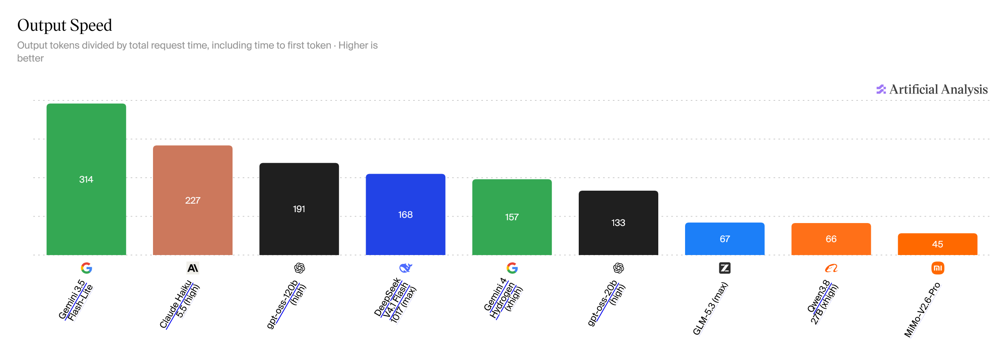

# ADR: Gemini y Groq como proveedores de LLM

## Decisión
Usamos la **API de Gemini** y **Groq** como proveedores.
- **Gemini:** permitimos cualquier modelo de texto de Google (se excluyen los de audio, imagen, embeddings, etc.). Recomendados: `gemini-flash-latest`, `gemini-flash-lite-latest` y `gemini-4-hydrogen`.
- **Groq:** solo una lista cerrada (inicialmente `openai/gpt-oss-120b` y `openai/gpt-oss-20b`).
- **Por defecto:** generador `gemini-flash-latest`, juez `gemini-flash-lite-latest`.

## Motivación
- Cada usuario aporta su **propia clave API**, así que el uso gratuito es un requisito.
- La tarea es sencilla: el LLM parafrasea hechos ya calculados, sin razonamiento complejo.
- **Juez distinto del generador:** detectar errores pequeños exige menos capacidad, y flash-lite tiene mucha más cuota gratuita (500 RPD frente a 20 de flash). Esto es clave porque cada explicación puede necesitar varias verificaciones y hasta 2 correcciones.
- **Dos proveedores:** el usuario puede cambiar si agota la cuota de uno, y las dos opciones son rápidas y admiten salida estructurada.
- **Groq limitado a gpt-oss:** no todos sus modelos admiten salida estructurada, y cada familia nueva añade particularidades de API.

## Alternativas
- **Un único proveedor:** integración más simple, pero sin alternativa si se agota la cuota gratuita.
- **Claude, OpenAI, DeepSeek:** sin uso gratuito (a fecha 23/11/2026).
- **Todos los modelos de Groq:** varios no admiten salida estructurada.
- **Modelos locales (Ollama):** privacidad total y sin claves, pero exigen hardware que un portátil de investigación no siempre tiene, aumentan mucho el tamaño de la instalación y los modelos pequeños son poco fiables con salida estructurada. Además, el objetivo es < 60 s por explicación.

## Consecuencias
- **Cuotas:** con `gemini-flash-latest` (5 RPM, 20 RPD) solo caben unas pocas explicaciones al día; con Groq gpt-oss son 30 RPM, 1 K RPD, 8 K TPM y 200 K TPD. El límite de 8 K tokens por minuto puede ser ajustado si el JSON de hechos es grande (10 tipos celulares × 50 rutas).
- **Privacidad:** al proveedor solo se envía el JSON de hechos, nunca los ficheros originales. Conviene confirmar con CIMUS que es aceptable y revisar cómo trata el proveedor los datos del plan gratuito.
- Los modelos y sus cuotas cambian con frecuencia; por eso la lista se consulta al proveedor y se cachea.

## Referencias
Comprobadas a día 23/11/2026.

Términos. RPM: solicitudes por minuto; RPD: solicitudes por día; TPM: tokens por minuto; TPD: tokens por día.

**Gemini**

No hay una sección online de documentación para los límites, sino que se han comprobado manualmente en una cuenta gratuita para los modelos recomendados.

| Modelo | RPM | RPD | TPM |
|---|---|---|---|
| gemini-4-hydrogen | 5 | 20 | 250K |
| gemini-flash-latest (gemini-3.8-flash) | 5 | 20 | 250K |
| gemini-flash-lite-latest (gemini-3.5-flash-lite) | 15 | 500 | 250K |

**Groq**

https://console.groq.com/docs/rate-limits

Modelos relevantes:

| Modelo | RPM | RPD | TPM | TPD |
|---|---|---|---|---|
| openai/gpt-oss-120b | 30 | 1K | 8K | 200K |
| openai/gpt-oss-20b | 30 | 1K | 8K | 200K |

Otros modelos de Groq con el mismo límite, pero no permitidos en la aplicación: `qwen/qwen3.8-27b` (30 / 1K / 8K / 200K).

- Documentación de salida estructurada de [Google](https://aistudio.google.com/docs/structured-output) y de [Groq](https://console.groq.com/docs/structured-outputs#models-with-strict-mode-strict-true).
- Benchmark de velocidad: [Artificial Analysis](https://artificialanalysis.ai/models?models=gemini-4-hydrogen,gemini-3-5-flash-lite,mimo-v2-6-pro,ling-3-1-flash,claude-haiku-5-5,deepseek-v4-1-flash-1017,qwen3-8-27b,glm-5-3,gpt-oss-120b,gpt-oss-20b#performance):

