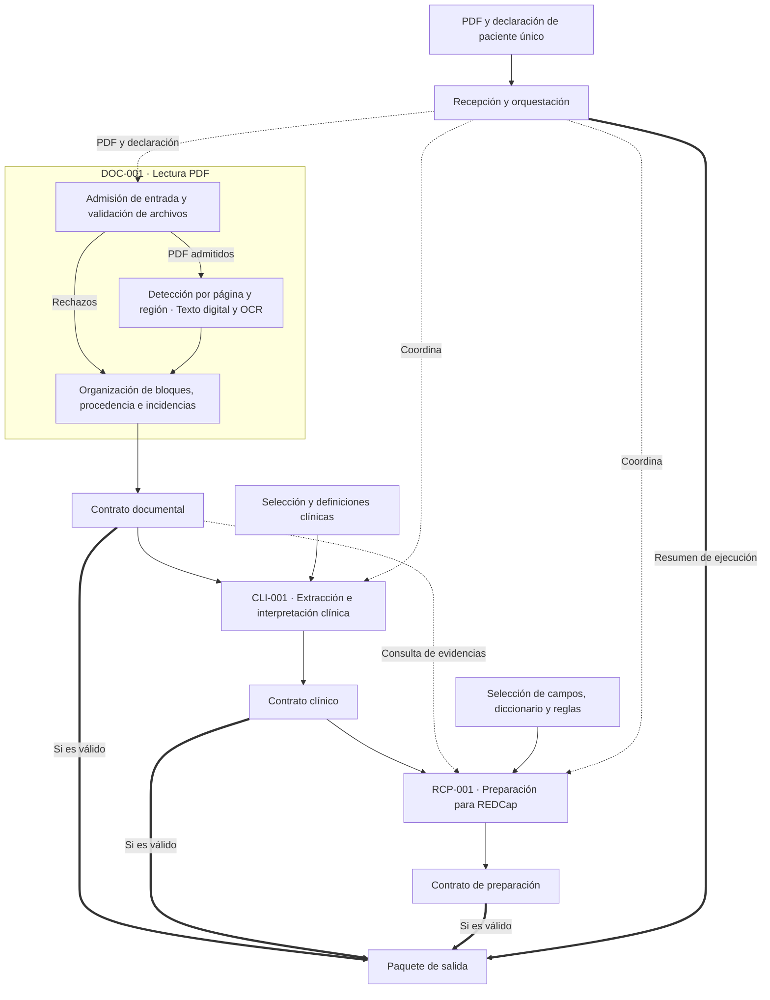

# Arquitectura del CU-04 · Extracción clínica para REDCap

**Estado documental** · Arquitectura de la Entrega 2 redactada y revisada técnicamente. La revisión cruzada con el ADR de formato intermedio consta en el seguimiento del equipo.

**Estado de aprobación** · Pendiente de visto bueno formal del equipo sobre la versión consolidada.

El CU-04 prepara documentación procedente de IANUS para que el personal investigador pueda localizar datos, comprobar su procedencia y obtener valores compatibles con las reglas suministradas para REDCap. La unidad de trabajo es una entrada de un único paciente. El alcance inicial propuesto admite uno o varios PDF de ese paciente y entrega resultados estructurados para comprobación o incorporación posterior. La obtención de los PDF y cualquier incorporación efectiva a REDCap quedan fuera de este flujo. [Alcance y contexto del proyecto](README.md)

Las responsabilidades funcionales proceden de las tres specs. Los ADR documentan propuestas técnicas respaldadas por experimentos. La coordinación local, el acceso a evidencias, el tratamiento de fallos entre módulos y el versionado que se describen aquí forman parte de la propuesta de arquitectura. Las decisiones del estudio y las condiciones de uso de datos clínicos se mantienen pendientes de acuerdo con Ceres Fernández Rozadilla y la entidad. [Estrategia de lectura de PDF](decisions/estrategia-lectura-pdf.md) · [Representación intermedia](decisions/formato-intermedio.md)

## Componentes y flujo

Las flechas finas continuas muestran el flujo de datos. Las punteadas distinguen las llamadas del orquestador y la consulta de evidencias. Las flechas gruesas muestran cómo el orquestador reúne el resumen y las entregas válidas disponibles, incluso si la preparación queda bloqueada. El orquestador entrega los PDF y la declaración a DOC-001 y coordina las llamadas a CLI-001 y RCP-001 según el estado de cada entrega.

### Recepción y orquestación

Se propone ejecutar el flujo como módulos Python en un proceso local. Compartir los contratos en memoria permite probar cada etapa por separado y recorrer las referencias sin introducir una API, una base de datos ni infraestructura distribuida. La solicitud reúne una lista ordenada de archivos, la declaración propuesta de que pertenecen a un único paciente y las dos selecciones con su configuración. Quien aporta los documentos es responsable de su agrupación. El sistema carece de identificación automática de pacientes.

El orquestador asigna una referencia única a cada ejecución, conserva las selecciones recibidas y comprueba las entregas. DOC-001 aplica la admisión documental, CLI-001 valida la selección clínica y RCP-001 comprueba la selección de campos, el diccionario y las reglas del estudio. Cada módulo comunica los motivos de su etapa. El orquestador registra sus efectos sobre el flujo.

### DOC-001 · Procesamiento documental

DOC-001 comprueba que hay archivos y una declaración de un único paciente. Asigna identificadores propios en orden de recepción, incluso si los nombres coinciden. Para admitir cada archivo, comprueba que tiene formato PDF, puede abrirse y contiene al menos una página. Registra motivos distinguibles para archivos vacíos, dañados, incompatibles o protegidos que impidan la apertura.

El ADR propone **PyMuPDF** para el texto digital visible y **PP-OCRv6 small** para escaneos, con **Tesseract** como contingencia en CPU. La decisión de lectura se toma por página y, cuando proceda, por región. Una página con texto digital puede contener una imagen que requiera OCR. La fusión propuesta debe conservar los bloques de ambas vías, su orden cuando sea determinable y su localización. Suprime únicamente la duplicación causada por capas superpuestas y conserva las repeticiones del original. Si falla una región, DOC-001 conserva los bloques recuperados de otras regiones de la misma página y registra el motivo, la localización y el efecto del fallo.

La etapa registra todas las páginas de los PDF admitidos, incluidas las vacías y las fallidas. Una página sin texto recuperado puede aportar un elemento utilizable si está descrito y localizado. La transcripción conserva el idioma y los caracteres recuperados. Cuando DOC-001 identifica una casilla, conserva su estado documental (marcada, sin marcar o indeterminada), la referencia y el localizador de los elementos y el vínculo a la etiqueta cuando pueda establecerlo. Las incidencias señalan relaciones inciertas, manuscritos ilegibles y limitaciones de lectura de tablas o casillas. DOC-001 conserva con advertencia las tachaduras legibles y omite el texto subyacente a ocultaciones opacas observables. [DOC-001](specs/ingesta-documentos.md) · [ADR de lectura](decisions/estrategia-lectura-pdf.md)

### CLI-001 · Extracción e interpretación clínica

La interfaz interna del motor recibe las definiciones clínicas y los bloques o elementos de la ejecución con sus referencias, asociaciones y limitaciones documentales. Por variable, el motor devuelve propuestas de menciones con contexto y referencias, las páginas, bloques o regiones examinados y los que quedaron fuera con su motivo. Indica si la búsqueda terminó, quedó interrumpida o truncada, o falló. CLI-001 contrasta esa cobertura con los estados e incidencias de DOC-001, verifica las evidencias y aplica los criterios clínicos. Para interpretar una casilla usa la asociación documental comunicada por DOC-001 y la conserva como indeterminada si DOC-001 carece de una asociación verificable. La interfaz permite comparar motores con las mismas entradas y casos de referencia. El ADR de [extracción clínica](decisions/extraccion-clinica.md) define el puerto `MotorExtraccion`, implementa `MotorReglas` como suelo de referencia ejecutable y deja diseñados (no ejecutados) los enfoques LLM local, LLM alojado e híbrido, pendientes de evaluación con recursos adecuados y de las autorizaciones necesarias. La recomendación condicional propone el motor de reglas para el prototipo, condicionada a que la comparativa con modelo real no lo supere de forma clara. [CLI-001](specs/extraccion-datos-clinicos.md) · [ADR extracción clínica](decisions/extraccion-clinica.md)

CLI-001 solo emite **no encontrado en la documentación disponible** si consta que la búsqueda terminó sobre el contenido evaluable pertinente y carece de menciones aplicables. Una lista vacía por sí sola no acredita que la búsqueda terminó. Si una interrupción o una región sin evaluar impide determinar el dato, o si su relevancia para la variable y el ámbito no puede establecerse, comunica insuficiencia o ambigüedad. Conserva los candidatos con respaldo independiente y la limitación de cobertura. Una evidencia que no se pueda verificar provoca una incidencia y deja sin respaldo el dato afectado.

Cada resultado conserva las menciones contextuales y los candidatos, con polaridad (afirmación, negación, sospecha o indeterminación), sujeto (paciente, familiar, tercero o desconocido) y ámbito temporal. Distingue la fecha del documento de la del hecho, mantiene su precisión y separa hechos históricos de actuales, así como prescripción, administración y tratamiento previo. Agrupa repeticiones inequívocas con todas sus evidencias, mantiene relaciones inciertas y conserva alternativas ante contradicciones o cuando falta una regla de selección temporal. Un informe posterior, por sí solo, carece de prioridad. CLI-001 entrega estados clínicos y evidencias. La codificación REDCap corresponde a RCP-001.

### RCP-001 · Preparación para REDCap

RCP-001 recibe la entrega clínica, acceso de solo lectura a sus evidencias y la selección de campos, el diccionario y las reglas del estudio. Para cada correspondencia examina el estado completo del resultado clínico, sus candidatos y menciones, polaridad, sujeto, ámbito temporal y relaciones. Ante una contradicción o selección temporal pendiente conserva las alternativas. El campo queda pendiente salvo que una regla autorizada y aplicable indique expresamente qué seleccionar a partir de los resultados ya interpretados o autorice un código para ese estado. La interpretación de las evidencias corresponde a CLI-001.

RCP-001 valida tipo, formato, opciones y códigos, unidad, precisión y restricciones. Solo aplica transformaciones expresamente definidas. Conserva los candidatos y sus evidencias si el valor de destino resulta incompatible. Identifica los campos calculados o descriptivos como no asignables y deja pendientes las anotaciones que requieren una regla específica. En una selección múltiple, cada asignación vincula la opción y su código con los resultados, menciones, evidencias y correspondencia que la sustentan. Las opciones sin respaldo quedan indeterminadas. La incorporación del conjunto parcial requiere una regla expresa.

Una vez preparados los valores locales, RCP-001 registra por separado las dependencias de visibilidad e incorporación. Cada dependencia conserva la regla, los valores o estados utilizados y el resultado **cumplida**, **incumplida** o **no evaluable**, con el motivo cuando proceda. Una condición circular, ininterpretable o sin datos utilizables queda no evaluable. Una regla explícita de exclusión aplicable deja la incorporación **excluida**. En ausencia de exclusión, la incorporación queda **pendiente** si una dependencia aplicable es no evaluable o falta una regla de incorporación necesaria, incluso cuando se cumpla la visibilidad. Una asignación es **proponible** cuando está validada y las condiciones aplicables de incorporación están resueltas a su favor. El valor validado localmente se conserva para revisión. La revisión humana y la incorporación efectiva pertenecen al flujo que se acuerde con la entidad. [RCP-001](specs/exportacion-redcap.md)

## Contratos y validación

El ADR propone **Pydantic v2** para los contratos Python, **JSON** cuando se necesite serializar o intercambiar y **validadores propios** para las invariantes. Los modelos anidados reducen el código de carga manual comparado en las PoC con `dataclasses`. JSON es una representación de intercambio de estos contratos. El formato final de incorporación a REDCap se decidirá aparte. [ADR de formato intermedio](decisions/formato-intermedio.md)

| Frontera | Información que circula |
|---|---|
| **DOC-001 → CLI-001** | Identidad de la entrega y estado global de la entrada. Documentos en orden con archivo y estado de admisión, páginas físicas desde 1 con naturaleza y estado de lectura, bloques de texto o elementos descritos con identificador, orden y localización cuando consten. Estados y asociaciones documentales de los elementos e incidencias con motivo, efecto y procedencia. |
| **CLI-001 → RCP-001** | Referencia a la entrega documental exacta y un resultado por variable solicitada. Incluye definición, estado de evaluación e interpretación, candidatos y menciones contextuales, sujeto, polaridad, fechas y su precisión, relaciones, cobertura e incidencias. Cada evidencia identifica el fragmento o descripción, su origen documental y la parte que sustenta. |
| **Salida de RCP-001** | Referencia a la entrega clínica y un resultado por campo solicitado. Incluye diccionario, definición, correspondencias y validaciones aplicadas o motivo de su ausencia. Conserva por separado los candidatos de origen y el valor preparado, con procedencia por opción cuando proceda. Incluye estados clínicos y de preparación, dependencias con sus datos de evaluación, incidencias y decisión de incorporación con su motivo. |

Cada entrega se comprueba en tres niveles.

1. **Estructura.** El modelo Pydantic comprueba tipos, atributos, estados admitidos y formatos en modo estricto. La frontera valida también las entregas recibidas en memoria. Una instancia Pydantic ya construida puede haber sido modificada y requiere una comprobación de su contenido antes de publicarse.
2. **Integridad y coherencia.** Los validadores comprueban identificadores únicos en su ámbito, identidad de las entregas enlazadas, correspondencia entre selección y resultados y coincidencia de cada evidencia con su fuente dentro de la cobertura declarada. DOC-001 comprueba el estado global en el orden de su spec, a partir de la admisión, el contenido efectivo y las incidencias. Un archivo rechazado carece de contenido atribuible. Un bloque con texto recuperado no vacío o un elemento descrito y localizado impide declarar **sin contenido utilizable**. Una negación documentada exige una mención negada con evidencia y un campo proponible exige valor validado y condiciones de incorporación resueltas.
3. **Validación funcional.** DOC-001 decide la admisión y qué contenido puede recuperar. CLI-001 determina si lo citado sustenta el hecho, el sujeto y el contexto. RCP-001 aplica las correspondencias y restricciones suministradas por el estudio. La coincidencia de una cita con el original recuperado acredita su procedencia. El juicio sobre lo que sustenta corresponde a CLI-001.

## Incidencias y ejecución parcial

Cada módulo comunica las incidencias que detecta, con motivo, efecto y referencia al nivel más preciso disponible. El paquete conserva todas las entregas válidas, incluidas las que contienen resultados pendientes. El resumen distingue etapas **ejecutadas con entrega válida**, **bloqueadas** por sus entradas o configuración y **fallidas** al ejecutar o validar su entrega. Para una etapa sin entrega, el resumen indica el motivo y las referencias de las variables o campos afectados si se conocen. Esas referencias son parte del desenlace de ejecución, sin estados clínicos ni asignaciones de destino.

| Situación | Motivo y entregas disponibles |
|---|---|
| Entrada vacía, sin declaración o declarada de varios pacientes | DOC-001 entrega **entrada no admitida** con el motivo. CLI-001 lo conserva en un aviso de bloqueo, sin invocar el motor. RCP-001 queda bloqueado. El paquete contiene la entrega documental y el resumen. |
| Entrada admitida con todos los PDF rechazados individualmente | DOC-001 registra el rechazo y motivo de cada archivo. El estado global es **sin contenido utilizable** y se aplica el tratamiento de la fila siguiente. |
| Entrada admitida sin contenido utilizable | DOC-001 conserva páginas y motivos cuando consten. Con una selección válida, CLI-001 entrega **información insuficiente** para las variables definidas, sin invocar el motor. RCP-001 conserva la causa para cada campo que dependa de esas variables. |
| Fallo localizado de archivo, página o región con contenido útil independiente | DOC-001 entrega **procesado con incidencias**. CLI-001 analiza el contenido evaluable y comunica la cobertura real. RCP-001 conserva la limitación junto al dato afectado y continúa con los campos independientes. |
| Selección de variables ausente o vacía | Si falta, CLI-001 comunica configuración incompleta, queda bloqueado y no entrega contrato. RCP-001 queda bloqueado por falta de entrada clínica. Si está vacía, CLI-001 comunica que no hay variables para extraer y entrega cero resultados. RCP-001 indica qué campos carecen del resultado necesario. |
| Selección de campos ausente o vacía | Con entrega clínica válida, RCP-001 comunica configuración incompleta si falta la selección y queda bloqueado. Si está vacía, entrega una preparación válida con cero campos y comunica ese motivo. |
| Selección de campos no vacía y diccionario ausente | Con entrega clínica válida, RCP-001 entrega un resultado **pendiente** por cada campo seleccionado, con el motivo de configuración incompleta y sin valor preparado. |
| Definición clínica, definición de campo o correspondencia insuficiente | CLI-001 registra la variable **no evaluable por definición insuficiente**. RCP-001 deja pendiente el campo que la requiere, o el campo cuya definición o correspondencia falta. Las etapas conservan sus resultados independientes. |
| Búsqueda incompleta o fallo del motor | CLI-001 conserva la evidencia independiente si dispone de una respuesta parcial comprobable, con la cobertura y el motivo de la interrupción. Si un fallo inesperado impide formar una entrega clínica válida, CLI-001 comunica el fallo, RCP-001 queda bloqueado y se conserva DOC-001. |
| Fallo inesperado de etapa, entrega inválida o esquema o versión incompatible | El orquestador comunica el fallo con el motivo disponible o un diagnóstico técnico de la etapa, bloquea a los consumidores y conserva las entregas anteriores válidas. Las incompatibilidades locales de un candidato o campo se expresan dentro de una entrega válida cuando el módulo puede aislarlas. |

Se comprueba primero el desenlace de la etapa de la que depende cada llamada. Con esa entrada disponible, el módulo correspondiente valida su configuración. CLI-001 verifica la definición de cada variable antes de informar de insuficiencia por falta de contenido. RCP-001 comprueba la selección antes del diccionario, que solo se necesita para preparar una selección no vacía.

## Trazabilidad y acceso a evidencias

Para cada valor preparado, RCP-001 conserva las referencias al resultado clínico y a las menciones que originan el valor, además de la definición y la regla aplicadas. La cadena se recorre de **campo → resultado y mención de CLI-001 → evidencia → entrada, documento, página física y bloque o elemento de DOC-001**. Los identificadores se interpretan dentro de su entrada y de sus ámbitos documentales. Si una evidencia sustenta el hecho y otra su fecha, se conservan ambas con su función. Un estado sin candidato conserva cobertura y motivos. Si una regla autoriza codificar un estado de ausencia, su fundamento es el resultado, la cobertura y la regla.

La entrega de DOC-001, incluidos sus bloques, elementos e incidencias, se publica validada e inmutable. Se identifica por la referencia de ejecución y la referencia de entrega. Si se reconstruye con cambios, recibe otra identidad. CLI-001 enlaza la entrega documental que consumió y RCP-001 verifica que su consulta de solo lectura corresponde a esa misma entrega. Un índice en memoria sobre ese artefacto basta para resolver las referencias sin reabrir el PDF.

CLI-001 contrasta la cobertura con los estados e incidencias de DOC-001, verifica las evidencias y aplica los criterios clínicos. El contrato clínico comprueba que el documento, la página y el elemento existen, pero no coteja el texto del fragmento; esa verificación la produce el arnés de evaluación, que sí tiene la entrada documental a mano. RCP-001 comprueba esa correspondencia al resolver las evidencias utilizadas para preparar un valor. Si alguna fuente necesaria no puede verificarse, registra la incidencia y deja el campo afectado sin validar.

Para pruebas sintéticas se propone un paquete autocontenido con el resumen, las entregas válidas, la configuración efectiva y la referencia de versión de los validadores. Así se pueden repetir las comprobaciones de las entregas. La PoC de RCP-001 conserva una instantánea clínica y la compara con su entrada. La resolución de la cadena completa requiere además la entrega de DOC-001. La conservación de entregas y originales con datos reales queda por acordar con la entidad. [Consecuencias y trabajo pendiente del ADR de formato](decisions/formato-intermedio.md#consecuencias)

## Versionado y compatibilidad

Como propuesta de arquitectura, cada entrega identificará el esquema de su frontera y una versión `mayor.menor` en los metadatos del contrato. Se registrarán aparte las referencias a la configuración clínica, al diccionario y a las reglas utilizadas. Así se puede reproducir una comprobación con la misma configuración aunque esta cambie sin que cambie la estructura del contrato.

El consumidor identifica esquema y versión antes de interpretar el contenido y declara las versiones admitidas. Para cada versión se selecciona el modelo correspondiente y se aplican las comprobaciones estrictas, incluidas las de referencias a entregas de la misma ejecución. Se conserva la política experimental `extra="forbid"` y el rechazo de estados desconocidos. Un campo opcional conocido puede faltar si el modelo lo permite. Si un productor añade ese campo y lo envía, un lector anterior estricto lo puede rechazar. Los cambios aditivos se publican con versión menor y requieren soporte explícito antes de emitirla. Los cambios de estructura o significado incompatibles incrementan la versión mayor. Se actualizan primero los lectores y sus pruebas de compatibilidad, después los productores. Una combinación desconocida se rechaza con un motivo explícito, sin descartar propiedades o reinterpretar estados.

La PoC de salida RCP comprueba una versión literal `"1"`. La política común de versiones está documentada como propuesta y queda pendiente de aprobación. Quedan por implementar la política y las pruebas de compatibilidad, así como el soporte simultáneo de versiones y las migraciones cuando se requieran.

## Recorrido sintético

Para la entrada ficticia `E1` se aportan dos PDF válidos y la declaración de un único paciente. En `D1/1/B1` DOC-001 recupera «En la valoración del 3 de marzo de 2026 se descarta afección Alfa en el paciente». En el escaneo `D2/1/B1` recupera «El 3 de marzo de 2026 se registra un valor de 125 u para el marcador Gamma». DOC-001 conserva la etiqueta de la prueba Épsilon en `D2/1/B2` y localiza la región del resultado manuscrito ilegible. Devuelve **procesado con incidencias**.

La selección clínica pide Alfa y Gamma en esa valoración, Delta en el contenido evaluable y el resultado de la prueba Épsilon. CLI-001 devuelve una **negación explícita documentada** de Alfa (`C1`, con `D1/1/B1`) y un candidato respaldado de Gamma (`C2`, 125 u, con `D2/1/B1`). Para Delta consta una búsqueda completada sobre el contenido evaluable pertinente, sin mención aplicable. La región ilegible está identificada como resultado de Épsilon. Delta queda **no encontrado** con cobertura declarada y sin candidato. Épsilon queda **información ambigua o insuficiente**, con la etiqueta y la incidencia de lectura.

La preparación usa un diccionario **completamente ficticio**. `alfa_presente` y `gamma_valor` toman sus definiciones sintéticas de DS-01. `delta_presente` y `epsilon_resultado` son campos añadidos solo para este ejemplo. Ningún código ni correspondencia de esta tabla se atribuye al estudio real. [Diccionario sintético DS-01](specs/exportacion-redcap.md#diccionario-sintetico-de-referencia-ds-01)

| Campo solicitado y regla sintética | Resultado de RCP-001 |
|---|---|
| `alfa_presente` admite `1` para afirmación confirmada y `0` para negación explícita aplicable. | **Validado y proponible** según la regla suministrada, con valor `0` y cadena `alfa_presente → C1 → D1/1/B1`. |
| `gamma_valor` admite números de 0 a 100 u. | **Incompatible** por rango. Conserva `C2`, 125 u y su evidencia. Sin valor preparado. |
| `delta_presente` exige afirmación o negación documentada y carece de código de ausencia. | **Sin dato para preparar**, con el resultado «no encontrado», su motivo y cobertura. |
| `epsilon_resultado` exige un resultado numérico con evidencia. | **Pendiente de resolución**, con referencia a la etiqueta, la región ilegible y la incidencia. Sin valor preparado. |

El resultado estructurado conserva los cuatro campos. Su propuesta de incorporación contiene únicamente `alfa_presente = 0`, vinculada a su regla y evidencia.

## Evidencia disponible y decisiones abiertas

- **Lectura documental.** En la evaluación local de cuatro páginas, PP-OCRv6 small tuvo menor error de reconocimiento que Tesseract en las regiones escaneadas comparables. Los tiempos corresponden a hardware distinto. La muestra local carecía de un caso verdaderamente mixto. En una página mixta sintética se ensayó el híbrido PyMuPDF/Tesseract. Un fallo de región puede interrumpir esa fusión experimental y perder los bloques acumulados. El adaptador Paddle ensayado usa otro intérprete local con tiempos límite. Queda por validar la fusión con PP-OCRv6 y por implementar y probar la conservación de bloques por región y la recuperación ante fallos del adaptador. También quedan pendientes la evaluación de formularios, manuscritos e idiomas y una referencia independiente para la extracción digital. [Evidencia experimental del ADR](decisions/estrategia-lectura-pdf.md#evidencia-experimental)
- **Contratos.** Las tres PoC de contratos usan datos preconstruidos. Sus 61 pruebas documentadas comprueban estructura, conservación y determinadas invariantes. Además, se ha implementado un prototipo de extracción clínica basado en reglas (`MotorReglas`) sobre casos sintéticos. La orquestación completa, la evaluación comparativa con modelos LLM y la ejecución de las reglas del estudio siguen pendientes de implementación o validación. Para evaluar alternativas clínicas se propone usar casos sintéticos con referencia previa que permitan comprobar estados, sujeto, fechas, cobertura y resolución de evidencias. Los criterios y umbrales de aceptación sobre documentación real siguen pendientes de acuerdo. [ADR de formato intermedio](decisions/formato-intermedio.md#evidencia-experimental)
- **Límites de las PoC.** Quedan por implementar y probar la inmutabilidad y la validación al entregar modelos en memoria, el cotejo de citas y la coherencia del estado documental. Las PoC clínicas registran cobertura por documento y carecen de las garantías propuestas para el fin de búsqueda y las asociaciones de formulario. La PoC de preparación conserva salidas preconstruidas. Quedan por comprobar el uso del estado clínico completo, la procedencia por opción y la evaluación de las dependencias y reglas de incorporación.
- **Problemas conocidos del contrato clínico (H1–H6).** El ADR de extracción clínica documenta seis límites: H1 (la cita textual no se verifica en el contrato, solo en el arnés), H2 (falta `desenlace_busqueda` en `ResultadoClinico`), H3 (falta `estado_casilla` en el contrato DOC→CLI), H4 (`temporalidad` es texto libre, no distingue prescripción/administración/antecedente), H5/H6 (argumento de CI corregido a reproducibilidad y privacidad). Estos afectan a 5 de 25 criterios (`CA06`, `CA07`, `CA18`, `CA23`, `CA24`) que quedan no evaluables en esta entrega.
- **Acuerdos con la entidad.** Quedan por definir las variables y campos prioritarios, los ámbitos temporales y criterios ante discrepancias, las correspondencias, códigos y reglas del estudio, el registro de referencia, la cobertura y formatos de entrada requeridos, y el procedimiento de revisión humana e incorporación posterior. El sistema se limita al apoyo a investigación, sin diagnósticos ni decisiones asistenciales, sin acceso directo a IANUS ni importación automática a REDCap. [Cuestiones pendientes del proyecto](README.md#pendiente-de-validación)
- **Confidencialidad.** El entorno autorizado, el acceso, el procesamiento, el almacenamiento, la retención y la eliminación de originales, temporales y resultados deben acordarse con la entidad. Los materiales que se presentan como anonimizados y sus derivados pueden contener información identificativa. Se excluyen los datos clínicos reales y sus derivados de GitHub y de las pruebas del repositorio. El procesamiento de documentación real mediante servicios externos requiere autorización. Las exportaciones de depuración quedan desactivadas para ejecuciones con datos reales mientras su uso esté sin acordar. [Privacidad en DOC-001](specs/ingesta-documentos.md#privacidad-y-decisiones-tecnicas-pendientes)
- **Diagnósticos.** En la salida de diagnósticos al usuario o a los registros, las excepciones, errores de validación y advertencias de serialización se traducen a códigos y motivos predefinidos, rutas de esquema conocidas y referencias opacas de ejecución o de elemento. Las trazas, los mensajes de excepción y el contenido de entrada quedan fuera del diagnóstico. `hide_input_in_errors=True` e `include_input=False` ayudan a ocultar valores, pero los nombres de claves desconocidas y las advertencias también requieren filtrado. La comprobación de logs y artefactos de depuración se hará con datos sintéticos. [Costes del formato intermedio](decisions/formato-intermedio.md#negativas-y-costes)
- **Preparación del PR oficial.** Completar la revisión del equipo y confirmar el plazo en el canal docente. Antes de presentar el PR, revisar el contenido y comprobar que el diagrama, los enlaces y la evidencia resumida en los ADR se ven desde la copia pública. [Organización de la entrega](README.md#organización-de-la-documentación-y-método-de-trabajo)

[Requisitos de la Entrega 2](https://github.com/usc-gria/piia2-26/blob/main/evaluacion/entrega-2.md)
