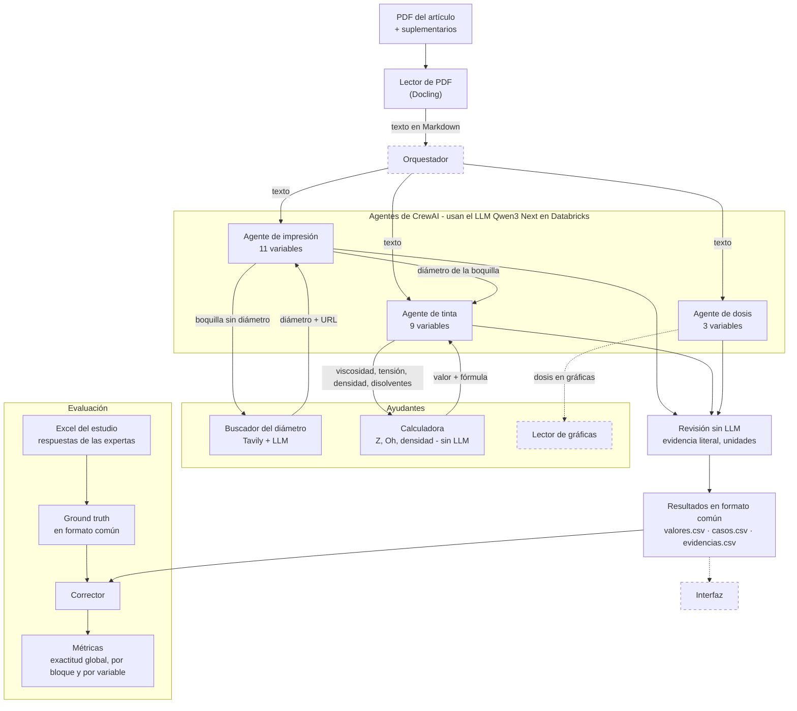

# Arquitectura

Sistema multiagente que lee un artículo de impresión farmacéutica por inyección de tinta (y su
material suplementario) y devuelve las 23 variables del estudio del iMATUS (Carou-Senra et al.,
*Int. J. Pharm.* 691, 2026), cada una con la frase del artículo de donde sale. Un corrector
automático compara el resultado con las respuestas de las expertas para medir la exactitud, con la
meta de igualar o superar el 94 % que consiguió GPT-4 en el estudio.

Las funcionalidades están en [`specs/`](specs/) y las decisiones de implementación en
[`decisions/`](decisions/).

## Diagrama

Las cajas con línea continua ya funcionan; las de línea discontinua están previstas. Los agentes
no hablan entre ellos: cada uno deja sus resultados y la siguiente pieza los lee.

## Componentes

| Componente | De qué se encarga | Recibe | Produce | Código | Estado |
|---|---|---|---|---|---|
| **Lector de PDF** | Pasar el artículo y cada suplementario a Markdown, con las tablas fila a fila; normaliza símbolos y quita la bibliografía | PDF | Un `.md` por fichero | `src/piia/lector_pdf/`, `scripts/04_pdf_a_texto.py` | Funciona |
| **Orquestador** | Lanzar los agentes que hagan falta según las variables pedidas, en orden, y juntar sus salidas en un único resultado por artículo, con tokens, tiempo y errores | Texto y lista de variables | Carpeta de resultados con las 23 variables | (previsto) | Previsto |
| **Agente de impresión** | Fármaco, impresora, tecnología, boquilla, sustrato, objeto impreso y sus proveedores, por cada caso (fármaco + impresora + sustrato) | Texto | Molde Pydantic: un dato por variable con valor, unidad, fuente, evidencia y ubicación | `src/piia/agentes/impresion.py` | Funciona |
| **Agente de tinta** | Viscosidad, tensión superficial, densidad, Z y Oh escritos, y los disolventes de cada tinta | Texto, diámetro de la boquilla (de los resultados de impresión) | Molde Pydantic por tinta | `src/piia/agentes/tinta.py` | Funciona |
| **Agente de dosis** | Dosis impresa, número de capas y área, por caso | Texto | Molde Pydantic por caso | `src/piia/agentes/dosis.py` | Funciona |
| **Ejecución común** | Lanzar cada paso con reintentos (2), contar tokens y tiempo y, si la respuesta no cabe, partirla en dos pasos (casos y después datos) | Pasos del agente | Salida o error del agente | `src/piia/agentes/ejecucion.py` | Funciona |
| **Configuración del LLM** | Crear el LLM en un único sitio, a partir de `.env`; toda `Crew` sin trazas | `.env` | `LLM` de CrewAI | `src/piia/config_llm.py` | Funciona |
| **Revisión sin LLM** | Descartar lo que no se puede comprobar: un valor del artículo sin frase literal en el texto pasa a "no reportado"; una boquilla que es solo un tamaño, también; pasar unidades a la fija | Molde del agente + texto | Tablas en formato común | `src/piia/agentes/molde.py`, `impresion.py` (boquilla), `src/piia/datos/unidades.py` | Funciona |
| **Buscador del diámetro** | Si el artículo no da el diámetro de la boquilla, buscarlo en internet con su modelo y fabricante; un agente lee las páginas y el código comprueba la frase, la unidad y que sea del mismo modelo | Nombre y fabricante de la boquilla | Diámetro con `fuente` internet y la URL | `src/piia/herramientas/buscador_diametro.py`, `scripts/11_completar_diametro.py` | Funciona |
| **Calculadora** | Hacer en Python las cuentas que el LLM no debe hacer: Z y Oh, densidad a partir de los disolventes (como el prompt 4 del estudio), viscosidad dinámica | Valores ya revisados | Valor calculado + fórmula y datos usados como evidencia | `src/piia/herramientas/calculadora.py`, `densidades.py` | Funciona |
| **Lector de gráficas** | Leer valores que solo están en figuras | Figura | Valor con su origen | (previsto) | Previsto |
| **Conversión del Excel** | Pasar las respuestas de las expertas (y las de GPT-4) del Excel del estudio al formato común | Excel del estudio | Ground truth en formato común | `src/piia/datos/excel_estudio.py`, `scripts/03_convertir_excel.py` | Funciona |
| **Corrector** | Emparejar los casos del sistema con los de las expertas y clasificar cada dato (TP, FP1, FP2, FN, TN) | Resultados + ground truth | `metricas.csv` (exactitud global, por bloque y por variable), `datos_clasificados.csv` | `src/piia/evaluacion/`, `scripts/05_corregir.py` | Funciona |
| **Interfaz** | Subir un artículo, elegir variables y ver la tabla con las evidencias | PDF + variables | Tabla de resultados | (previsto) | Previsto |

## Flujo de principio a fin

Ejemplo inventado: un artículo imprime una tinta con el «Fármaco X» en una impresora «PrintoMat
Z-10» sobre una película oral.

1. **Lectura.** El lector convierte el PDF y su suplementario a Markdown. Los dos textos se juntan
   con un separador (`=== ARTÍCULO ===`, `=== SUPLEMENTARIO ===`) para que el agente sepa de qué
   parte sale cada dato.
2. **Orquestación.** El orquestador decide qué agentes hacen falta según las variables pedidas.
   Hoy cada agente se lanza con su script (`06_extraer_impresion.py`, `12_extraer_tinta.py`,
   `13_extraer_dosis.py`); el orquestador los encadenará en este orden.
3. **Impresión.** El agente de impresión identifica los casos (fármaco + impresora + sustrato) y,
   para cada variable, devuelve el valor, la unidad, la fuente y la frase literal, por ejemplo
   `Inkjet_printer = "PrintoMat Z-10"` con la evidencia «printed with a PrintoMat Z-10 printer».
   Si el dato no está, contesta "no reportado" en vez de inventarlo.
4. **Buscador.** Si la boquilla tiene nombre pero el artículo no da su diámetro, el buscador lo
   busca en internet solo con el nombre y el fabricante (nunca con texto del artículo). El dato
   entra con `fuente` internet y la URL.
5. **Tinta y calculadora.** El agente de tinta lee lo que el texto escribe (viscosidad, tensión,
   densidad, disolventes). La calculadora, no el LLM, calcula la densidad si falta y Z y Oh, y
   guarda la fórmula y los datos como evidencia. El diámetro para Z y Oh lo lee el código de los
   resultados de impresión (pasos 3 y 4), solo si el artículo tiene un único diámetro: con varios
   no se sabe cuál corresponde a cada tinta y Z y Oh quedan como "no reportado". Así se aprovecha
   el buscador, no se gastan llamadas al LLM y no se adivina con varias boquillas. Hoy este traspaso
   se hace al lanzar el agente de tinta (`12_extraer_tinta.py --impresion <resultados>`); con el
   orquestador será automático.
6. **Dosis.** El agente de dosis saca la dosis impresa, el número de capas y el área de cada caso.
7. **Revisión.** Antes de guardar, el código descarta lo que no se puede comprobar: un valor sin
   frase literal en el texto pasa a "no reportado", y los números se pasan a la unidad fija de cada
   variable.
8. **Salida.** Todo se escribe en el formato común: `valores.csv` (una fila por artículo × caso ×
   variable), `casos.csv` y `evidencias.csv` (frase, ubicación y nota de cada dato), más el registro
   de tokens, tiempo y errores por artículo.
9. **Evaluación.** El corrector empareja los casos con los de las expertas y da la exactitud,
   (TP + TN) / total como en el estudio, con dos notas: la flexible, que acepta el mismo dato escrito
   de otra forma, y la estricta.

## Datos y dónde viven

- **Artículos:** 70 artículos del estudio, separados al principio en 20 de **desarrollo** y 50
  **reservados** para la prueba final. Los reservados no se abren ni se procesan hasta entonces,
  para que la nota final no salga inflada.
- **Fuera de GitHub:** los PDF, los textos convertidos, el Excel, el ground truth y los resultados
  viven en la carpeta `data/` de cada ordenador y en una carpeta compartida. La CI falla si alguno
  entra en el repositorio. Las claves (Databricks, Tavily) solo están en `.env`.
- **Formato común:** el ground truth, las respuestas de GPT-4 del estudio y las de nuestro sistema
  se guardan igual, así que el corrector compara los tres sin conversiones.

## Decisiones transversales

- **Un solo LLM, definido en un único sitio** (`config_llm.py`); para cambiar de modelo solo se
  cambia una variable de `.env`. Por qué este modelo: ver [`decisions/`](decisions/).
- **Sin trazas de CrewAI** (`tracing=False`): incluirían el texto de los artículos.
- **El LLM no calcula ni inventa:** todo valor derivado pasa por la calculadora y todo valor del
  artículo necesita su frase literal.
- **Salida válida siempre:** si un agente falla tras 2 reintentos, sus variables salen como "no
  reportado" con la nota `error_agente` y el resto del artículo se entrega igual.
