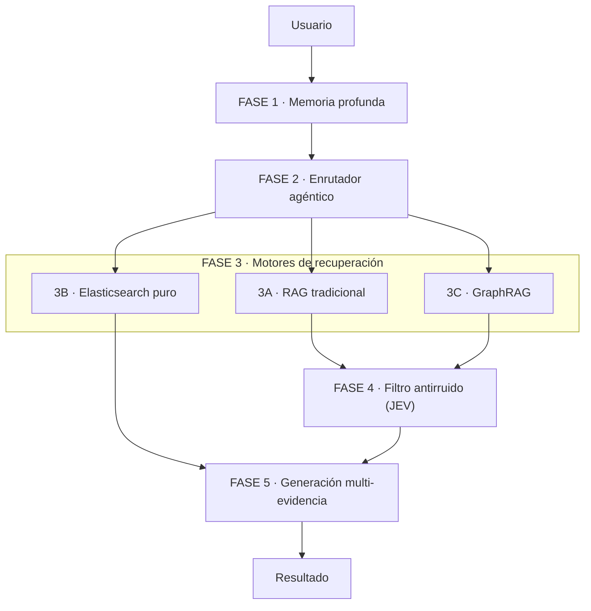

# ARCHITECTURE.md - CU-09

## Diagrama de arquitectura

## Componentes

- **Memoria profunda:** mantiene el contexto de la conversación mediante resúmenes acumulativos y un conjunto de documentos relacionados, que hemos denominado *subgrafo activo*. Esto permite recordar información de consultas anteriores y gestionar conversaciones largas sin perder el contexto.

- **Enrutador agéntico:** utiliza un LLM para analizar la intención de la consulta, teniendo en cuenta el contexto de la conversación. Según si se solicitan (A) datos concretos, (B) listados o (C) relaciones entre documentos, selecciona el motor de recuperación más adecuado.

- **Motores de recuperación:** permiten obtener información mediante tres estrategias diferentes.
  - **RAG tradicional:** esta opción estaba previamente implementada por el equipo de Imaxin. Combina búsquedas semánticas en Qdrant y búsquedas por palabras clave en Elasticsearch para localizar fragmentos relevantes y responder preguntas específicas.
  - **Elasticsearch puro:** realiza filtros por entidad, sección, subsección y fecha para obtener listados y conteos, agrupando por documento para evitar duplicados. Sus resultados pasan directamente a la generación, sin pasar por JEV, para conservar los documentos y conteos obtenidos mediante filtros exactos.
  - **GraphRAG:** utiliza una base de datos de grafos de relaciones entre entidades, normativas y requisitos para recuperar información conectada de distintos documentos, permitiendo comparaciones y consultas más complejas.

- **Filtro antirruido (JEV):** evalúa la información recuperada mediante una clasificación binaria que determina si cada fragmento es relevante para la consulta. Después descarta la información innecesaria antes de enviarla al modelo generador, reduciendo el riesgo de respuestas incorrectas.

- **Generación multi-evidencia:** utiliza un LLM para elaborar respuestas a partir de múltiples fragmentos previamente validados, incluso cuando proceden de documentos diferentes. Incorpora citas con el título y la URL de cada fuente, garantizando la trazabilidad de la información y evitando confundir distintas normativas.

## Flujo entre componentes

1. El **usuario** envía una consulta.
2. La **memoria profunda** aporta el contexto.
3. el **enrutador agéntico** elige uno de los tres **motores de recuperación**.
4. Los fragmentos recuperados por el RAG tradicional y GraphRAG pasan por el **filtro binario JEV**. Los listados y conteos de Elasticsearch pasan directamente a la generación.
5. Los fragmentos relevantes o los resultados de Elasticsearch llegan al módulo de **generación multi-evidencia**, que devuelve el **resultado** al usuario con las citas correspondientes.
