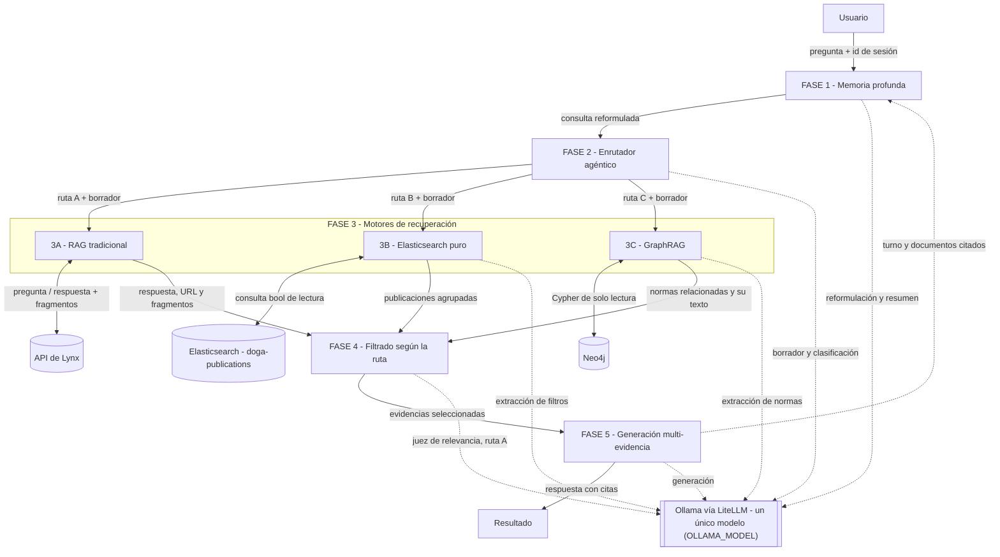

# Arquitectura

## Diagrama de arquitectura

Los cilindros son servicios de Imaxin que solo consultamos. Todas las fases usan el mismo modelo local a través de `_call_llm`.

## Componentes

- **Memoria profunda** ([spec](specs/memoria-sesion.md)): mantiene el contexto de la conversación mediante resúmenes acumulativos, turnos recientes y metadatos de documentos relacionados, que hemos denominado *subgrafo activo*. Esto ayuda a recordar información de consultas anteriores y gestionar conversaciones largas. El subgrafo activo pertenece a la memoria de la sesión y es independiente del grafo de recuperación de Neo4j. Guarda los 2 últimos turnos, un resumen de hasta 1200 caracteres y hasta 10 documentos por sesión, en memoria y, si se configura `MEMORY_DIR`, en un JSON por sesión.
  - Recibe: la pregunta del usuario y el `session_id`; al final de cada turno, la respuesta y los documentos citados.
  - Produce: la consulta reformulada como pregunta autónoma. El subgrafo activo solo se usa dentro de la reformulación y no sale de este componente.

- **Enrutador agéntico** ([spec](specs/enrutador-agentico.md)): genera siempre un borrador hipotético y después combina reglas para los casos claros con la clasificación de un LLM. Recibe la consulta reformulada por la memoria y, según si se solicitan (A) datos concretos, (B) listados por metadatos o (C) relaciones entre normas citadas, selecciona el motor de recuperación más adecuado. Las reglas mandan a C si hay una palabra de relación y un tipo de norma, y a B si hay una palabra de listado y un metadato; si ninguna se cumple, el LLM responde con una letra y, si no es válida, se elige la ruta A.
  - Recibe: la consulta reformulada.
  - Produce: la ruta elegida (`A`, `B` o `C`), la consulta y el borrador hipotético, que pasa al motor como respuesta provisional.

- **Motores de recuperación:** permiten obtener información mediante tres estrategias diferentes.
  - **RAG tradicional:** esta opción estaba previamente implementada por el equipo de Imaxin. Se integra mediante la API de Lynx, que devuelve para un solo documento la respuesta, su URL y tres fragmentos (el usado y sus vecinos).
  - **Elasticsearch puro** ([spec](specs/elasticsearch-listados-agregaciones.md)): extrae con un LLM los filtros de la consulta, valida sus valores contra los que existen en el índice (que se consultan en cada pregunta) y busca por entidad, sección, subsección, fecha, idioma e identificadores. Si un valor no existe, la ruta se queda sin fuentes. Recupera todos los fragmentos coincidentes; el pipeline los agrupa por `file_id` y conserva hasta 20 publicaciones y dos fragmentos por publicación para la generación. El idioma es opcional y siguen pendientes los recuentos exhaustivos de publicaciones únicas, las agregaciones y el total de resultados. La forma de construir la consulta está en el [ADR](decisions/llm-extrae-parametros-codigo-construye-consultas.md).
  - **GraphRAG** ([spec](specs/motor-graphrag.md)): utiliza Neo4j para buscar las normas citadas en la pregunta y recuperar sus relaciones directas, a un salto, mediante consultas Cypher fijas de solo lectura que no dependen del esquema del grafo. El texto de los documentos sale de las propiedades de los nodos. 
  - Reciben: la consulta reformulada y el borrador.
  - Producen: documentos con título, URL y texto (en B, con su `file_id`); la ruta A añade la respuesta de Lynx y la ruta C las relaciones en forma de hechos ("A -[MODIFICA]-> B"). Si se encuentran fuentes, sustituyen al borrador.

- **Filtro antirruido y comprobación de contenido** ([ADR](decisions/filtro-validador-adr.md)): en la ruta A, una clasificación binaria (JEV) evalúa si la respuesta de Lynx es relevante, utilizando los fragmentos como contexto; si el juez falla, la respuesta se descarta. En las rutas B y C se comprueba que los documentos tengan título y contenido, conservando las coincidencias de metadatos o las relaciones del grafo sin aplicar el filtro temático del LLM. 
  - Recibe: los resultados del motor elegido y la consulta.
  - Produce: las evidencias que se conservan, con sus metadatos; si no queda ninguna, una lista vacía.

- **Generación multi-evidencia:** utiliza un LLM para elaborar respuestas a partir de múltiples fragmentos seleccionados, incluso cuando proceden de documentos diferentes. Solicita citas con el formato `[Doc N, Chunk M]`, títulos y URLs cuando estén disponibles, aunque no comprueba que el modelo las incluya. Si no hay evidencias, pide al modelo que diga que no se ha consultado ningún documento. Si la llamada falla o devuelve texto vacío, conserva el borrador, que puede no estar verificado: cuando no se encontraron fuentes, es el borrador hipotético del enrutador. En la ruta B, si la respuesta omite títulos de las publicaciones seleccionadas, el pipeline devuelve el listado construido con los resultados recuperados. 
  - Recibe: la consulta, las evidencias filtradas y el borrador.
  - Produce: la respuesta final con citas, y el registro del turno para la memoria.

- **Servicios compartidos:** las llamadas directas a los modelos se centralizan en `_call_llm`, usando Ollama mediante LiteLLM con un único modelo para todas las fases (`OLLAMA_MODEL`; `qwen2.5:0.5b` por defecto y Salamandra 2B en nuestras pruebas). La configuración está en `src/config.py`. Si Ollama no responde, el error se propaga y el turno falla.

## Flujo entre componentes

1. El **usuario** envía una consulta asociada a una sesión.
2. La **memoria profunda** aporta el contexto y reformula las preguntas de seguimiento como consultas autónomas. La primera pregunta de la sesión pasa sin cambios.
3. El **enrutador agéntico** genera el borrador, aplica sus reglas y, si ninguna se cumple, usa el LLM para elegir uno de los tres **motores de recuperación**. El motor elegido consulta su fuente (la API de Lynx, el índice de Elasticsearch o Neo4j) y devuelve los documentos encontrados.
4. La respuesta de Lynx pasa por el **filtro de relevancia**. Los resultados de Elasticsearch y GraphRAG se agrupan y se comprueba que tengan título y contenido.
5. Los documentos seleccionados llegan al módulo de **generación multi-evidencia**, que solicita una respuesta con referencias. En la ruta B se comprueba además la presencia de los títulos del listado seleccionado y se recupera ese listado si el modelo los omite.
6. Se registran el turno completado y los metadatos de los documentos en la **memoria profunda**, y se devuelve el **resultado** al usuario.
