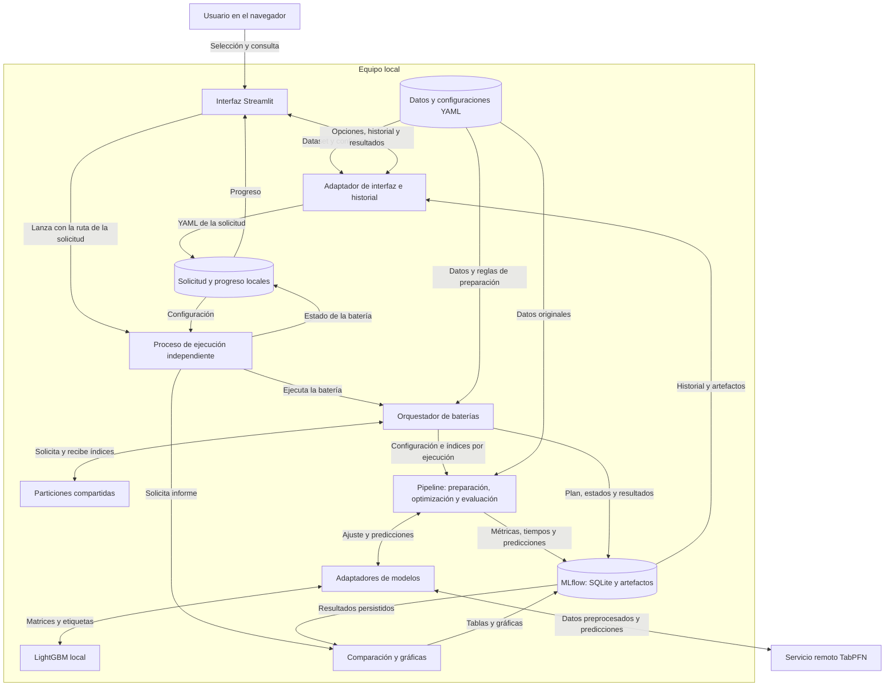

# Arquitectura de la solución

## Contexto y alcance

El sistema es un prototipo local de experimentación para comparar clasificadores tabulares desde Streamlit. La implementación actual utiliza LightGBM como baseline local y TabPFN preentrenado mediante un servicio remoto. Ambos se ejecutan con un pipeline común y sus resultados se conservan en MLflow. La elección permite estudiar un modelo fundacional frente a un método tradicional sin entrenar un modelo fundacional desde cero.

La arquitectura se basa en la [revisión e6e52c4 del proyecto](https://github.com/RodrigoRego5/Modelos_Fundacionales/tree/e6e52c4ede57066659d9ee31b637c63640c7bd52). Soporta las funcionalidades de [ejecución de experimentos](./specs/comparar-modelos.md) y [consulta de resultados](./specs/consultar-resultados.md). La última sección identifica los requisitos que todavía necesitan desarrollo; esta entrega documenta el diseño y no certifica que todas las specs estén implementadas.

## Diagrama

Las flechas indican llamadas o transferencias de información. El servicio TabPFN es la única pieza de cómputo remoto del flujo actual.

## Componentes y responsabilidades

Las rutas de código de esta tabla son relativas a la raíz de la implementación enlazada al final del documento.

| Componente | Implementación | Entrada, responsabilidad y salida |
|---|---|---|
| Interfaz y adaptador | `streamlit_app.py`, `app/dashboard.py` | Reciben las elecciones del usuario, muestran una vista previa, construyen los YAML y permiten consultar progreso, historial, tablas y gráficas. El adaptador conserva la solicitud; la interfaz lanza el proceso de ejecución. |
| Datos y configuración | `data/`, `configs/`, `app/config.py`, `app/datasets.py` | Los CSV/Excel y YAML definen datos, objetivo, limpieza, partición, modelos y métricas. Se validan las reglas, se eliminan filas sin objetivo e identificadores configurados y se obtiene `X` junto con un objetivo binario `y`, codificado como 0/1. |
| Proceso de ejecución | `app/dashboard_worker.py` | Recibe la ruta del YAML, llama al orquestador, escribe el progreso y solicita las gráficas al terminar. Aísla el estado de MLflow de las sesiones de Streamlit. |
| Orquestador y particiones | `app/batteries.py`, `app/partitions.py` | Expanden datasets, modelos, semillas, tamaños y variantes en un plan validado antes de entrenar. Materializan índices compartidos, comprueban la identidad de los datos y ejecutan cada trabajo secuencialmente. |
| Pipeline común | `app/pipeline.py`, `app/conditions.py`, `app/preprocessing.py`, `app/optimization.py`, `app/evaluation.py` | Recibe configuración, modelo y partición. Selecciona variables, aplica condiciones al entrenamiento, ajusta imputación/codificación y, opcionalmente, hiperparámetros y umbral. Coordina el modelo y calcula métricas y tiempos sobre el test. |
| Adaptadores de modelos | `app/models.py` | Construyen `LGBMClassifier` o `TabPFNClassifier` de `tabpfn-client` con los parámetros configurados. Exponen operaciones de ajuste, predicción y probabilidades al mismo pipeline. LightGBM se ejecuta localmente; TabPFN utiliza el servicio externo. |
| Seguimiento | `app/tracking.py`, MLflow | Registra configuración, parámetros, métricas y contexto. SQLite conserva los metadatos de las ejecuciones; el almacenamiento de artefactos conserva planes, predicciones, resultados y gráficas. |
| Comparación | `app/comparison.py` | Lee resultados persistidos, selecciona pares completos LightGBM/TabPFN y produce agregados, diferencias pareadas y PNG con pandas, Seaborn y Matplotlib. La interfaz consulta esos artefactos sin repetir entrenamientos. |
| Archivos de ejecución | `results/streamlit/<id>/` | Conservan la solicitud YAML, metadatos, progreso y registro del proceso. Permiten seguir la ejecución; el historial de resultados procede de MLflow. |

La CLI también puede invocar las baterías o el pipeline individual. Los notebooks sirven para exploración y análisis y reutilizan componentes del proyecto; no constituyen un servicio necesario para la interfaz.

## Flujo de principio a fin

1. **Seleccionar y configurar.** El usuario elige un dataset registrado y las condiciones de comparación. Los tres datasets actuales son Framingham (`TenYearCHD`), Telco (`Churn`) y crédito (`default payment next month`). La interfaz actual prepara una comparación de LightGBM y TabPFN. El adaptador guarda los YAML de la solicitud y la interfaz inicia el proceso independiente.
2. **Validar y planificar.** El orquestador carga los datos, aplica la preparación determinista y valida toda la matriz experimental. Para cada semilla crea una partición estratificada de entrenamiento/test. Los modelos comparten los índices y el test permanece fijo al variar el tamaño de entrenamiento. El plan guarda índices, semillas y huellas SHA-256 de los datos y de la configuración de partición.
3. **Preparar y ajustar.** Para cada trabajo se invoca el pipeline con su configuración y partición. La selección de variables y las condiciones de robustez siguen la variante configurada. La imputación y codificación se aprenden solo del entrenamiento. Si se activa optimización, primero se seleccionan hiperparámetros mediante validación cruzada interna y después el umbral con probabilidades fuera de muestra del entrenamiento (*out-of-fold*). Cada fold ajusta su propio preprocesamiento; las perturbaciones afectan únicamente a su parte de entrenamiento.
4. **Evaluar.** Con los parámetros elegidos se ajusta el modelo final y se predice el test reservado. El pipeline obtiene etiquetas y probabilidades de la clase positiva; aplica el umbral seleccionado si existe o conserva la decisión del estimador. Calcula las métricas solicitadas, incluidas ROC-AUC, average precision, recall y F1. `average_precision` y `pr_auc` son métricas distintas: la segunda usa integración trapezoidal de la curva precisión–recall.
5. **Registrar.** Una ejecución padre de MLflow agrupa la batería y una hija representa cada trabajo del plan, con sus búsquedas opcionales y ajuste final. Se guardan resultados, predicciones y contexto. Si falla un modelo, la tabla conserva el error y el orquestador continúa con los restantes. El proceso publica el progreso al inicio y tras cada trabajo; terminar la batería no implica que todos sus modelos hayan terminado correctamente.
6. **Consultar y comparar.** El proceso solicita las gráficas a partir de los resultados guardados. Se comparan únicamente pares completados con igual dataset, variante, partición y huella del test; se mantienen separados los tamaños de entrenamiento. Se muestran medias, desviaciones estándar entre semillas y diferencias TabPFN menos LightGBM. Las ejecuciones fallidas o sin pareja siguen visibles en la tabla completa. Si falla la generación de gráficas, los resultados ya registrados se pueden consultar.

El protocolo se justifica en el [ADR de evaluación pareada](./decisions/evaluacion-pareada.md); la persistencia y organización de ejecuciones, en el [ADR de seguimiento con MLflow](./decisions/seguimiento-mlflow.md).

## Persistencia y límites operativos

| Ubicación | Información conservada |
|---|---|
| `mlflow.db` | Experimentos, ejecuciones, estados, parámetros, métricas y etiquetas. |
| Artefactos del padre en `mlruns/` | `plan.json`, `results.csv` y `summary.json`; para ejecuciones desde la interfaz, configuración en `dashboard/` e informe gráfico en `comparison/`. |
| Artefactos de cada hija en `mlruns/` | Configuración y partición; en ejecuciones completadas, contexto y tiempos en `result.json`, condiciones y `predictions.csv` con índice, etiqueta real, etiqueta predicha y probabilidad positiva. Las búsquedas opcionales añaden sus propios resultados. |
| `results/streamlit/<id>/` | YAML enviados, metadatos, `progress.json` y registro del proceso. |

MLflow funciona con almacenamiento local sin requerir un servidor de seguimiento; su interfaz web es opcional. No se introduce una API propia ni un despliegue productivo. El registro conserva versiones y huellas para auditar el experimento, pero repetirlo exige mantener los datos originales y un entorno compatible. Los objetos ajustados se devuelven al llamador del pipeline; este flujo no constituye un registro de modelos desplegables.

TabPFN necesita conexión, credenciales y cuota del servicio. El token se proporciona por entorno o por el campo de contraseña y se transmite al proceso mediante su entorno, sin incorporarlo a los YAML ni a los parámetros de MLflow. Los datos preprocesados se envían al servicio; incorporar un caso industrial requiere comprobar que admite este modo de ejecución.

Los tiempos de TabPFN incluyen red y servicio remoto, mientras que LightGBM se ejecuta localmente. El registro actual recoge plataforma y versiones, pero no identifica de forma completa el hardware local/remoto; no permite concluir una equivalencia de recursos. Se miden ajuste, inferencia, preprocesamiento y búsquedas por separado. No hay cancelación ni reanudación automática de baterías parciales.

## Correspondencia con las specs de la entrega 1

Se mantiene el alcance funcional original. La implementación incorpora también carga libre de archivos, pero esa ampliación no forma parte del alcance exigido por estas specs.

| Requisito | Soporte actual y trabajo pendiente dentro de la arquitectura |
|---|---|
| Selección, metadatos y ejecución — [spec de experimentos](./specs/comparar-modelos.md), criterios 1–3 | Hay catálogo de tres datasets, configuración y progreso. Las baterías admiten seleccionar modelos por YAML, pero la interfaz ejecuta la pareja fija. Queda completar el selector de modelos y la presentación explícita del problema y de ambas clases para todos los datasets registrados. Esto corresponde a la interfaz y su adaptador. |
| Protocolo reproducible y ausencia de fuga — misma spec, criterios 4–5 | El orquestador y el pipeline registran particiones, semillas, configuración, versiones y predicciones. Las búsquedas reciben únicamente entrenamiento. |
| Baselines de SDG Group — ambas specs | LightGBM es el baseline experimental actual; no se identifica como un baseline industrial ya recibido. Queda incorporar los casos y sus referencias: el adaptador deberá asociar resultados y metadatos de procedencia, y la comparación comprobará objetivo, filas de evaluación y protocolo. Una referencia no verificable se mostrará separada, sin entrar en los agregados pareados. |
| Fallos y consulta de resultados sin baseline — spec de experimentos, criterios 7–8 | Se registran errores y se conservan en la tabla las ejecuciones completadas aunque no tengan pareja. Los agregados comparativos requieren ambos modelos. |
| Métricas, matriz de confusión y curvas — [spec de resultados](./specs/consultar-resultados.md), criterios 1–4 | Existen métricas configurables y predicciones individuales persistidas. Queda completar en la vista las cuatro métricas obligatorias, clases, protocolo y umbral, las matrices de confusión y curvas ROC/PR, y la explicación de cada dato no disponible. La comparación podrá obtener las curvas y matrices de las predicciones de cada hija; no se reconstruirán a partir de métricas agregadas. |
| Tiempos y hardware — spec de resultados, criterio 5 | Se muestran tiempos separados en segundos y se advierte del servicio remoto. Queda completar la identificación del hardware o indicar «No disponible», y «No aplica» para una fase inexistente. El tiempo de `fit` de TabPFN no significa entrenamiento del modelo fundacional desde cero. |
| Informe final — spec de resultados, criterio 7 | El equipo redactará el Markdown a partir de resultados y protocolos registrados. Los CSV y PNG facilitan ese análisis; su generación automática no sustituye el informe ni acredita conclusiones sobre casos todavía no evaluados. |

## Referencias de implementación

- [README y estructura del proyecto](https://github.com/RodrigoRego5/Modelos_Fundacionales/blob/e6e52c4ede57066659d9ee31b637c63640c7bd52/README.md).
- [Interfaz Streamlit](https://github.com/RodrigoRego5/Modelos_Fundacionales/blob/e6e52c4ede57066659d9ee31b637c63640c7bd52/streamlit_app.py) y [proceso de ejecución](https://github.com/RodrigoRego5/Modelos_Fundacionales/blob/e6e52c4ede57066659d9ee31b637c63640c7bd52/app/dashboard_worker.py).
- [Pipeline común](https://github.com/RodrigoRego5/Modelos_Fundacionales/blob/e6e52c4ede57066659d9ee31b637c63640c7bd52/app/pipeline.py), [adaptadores de modelos](https://github.com/RodrigoRego5/Modelos_Fundacionales/blob/e6e52c4ede57066659d9ee31b637c63640c7bd52/app/models.py) y [comparación](https://github.com/RodrigoRego5/Modelos_Fundacionales/blob/e6e52c4ede57066659d9ee31b637c63640c7bd52/app/comparison.py).
