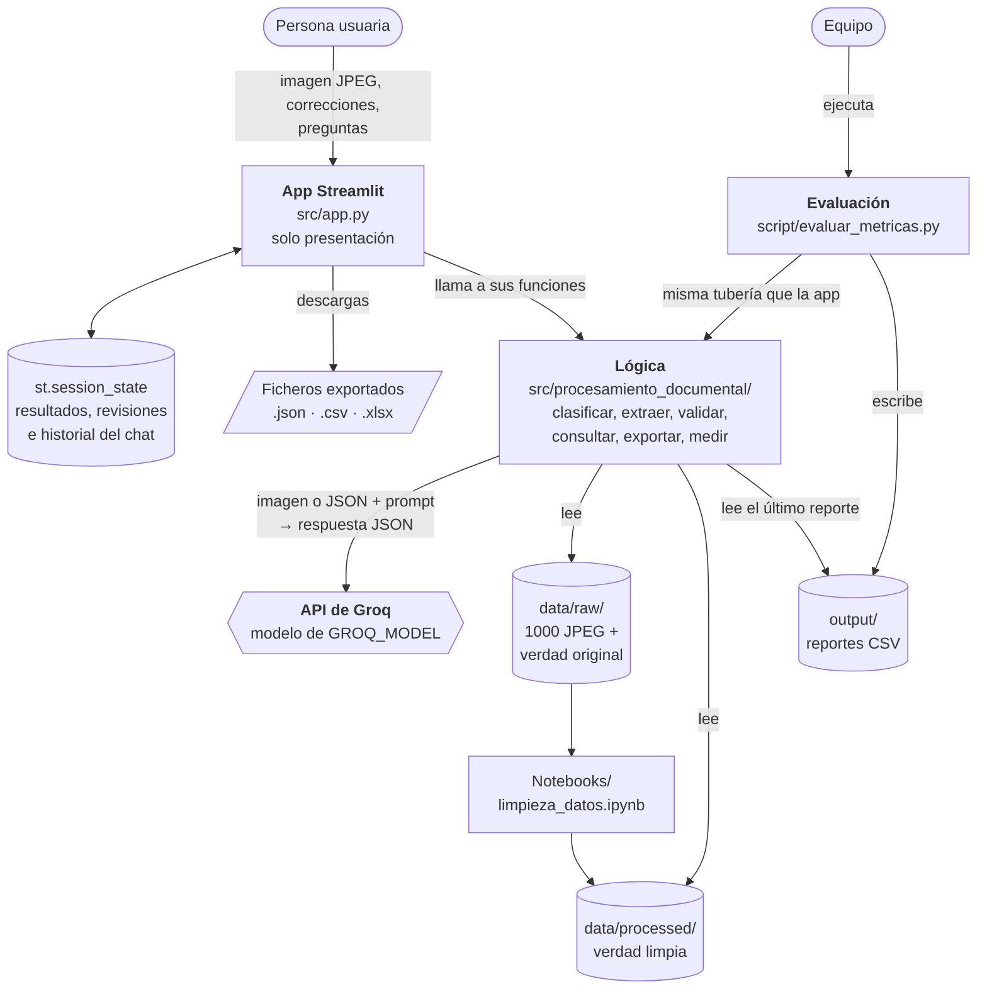
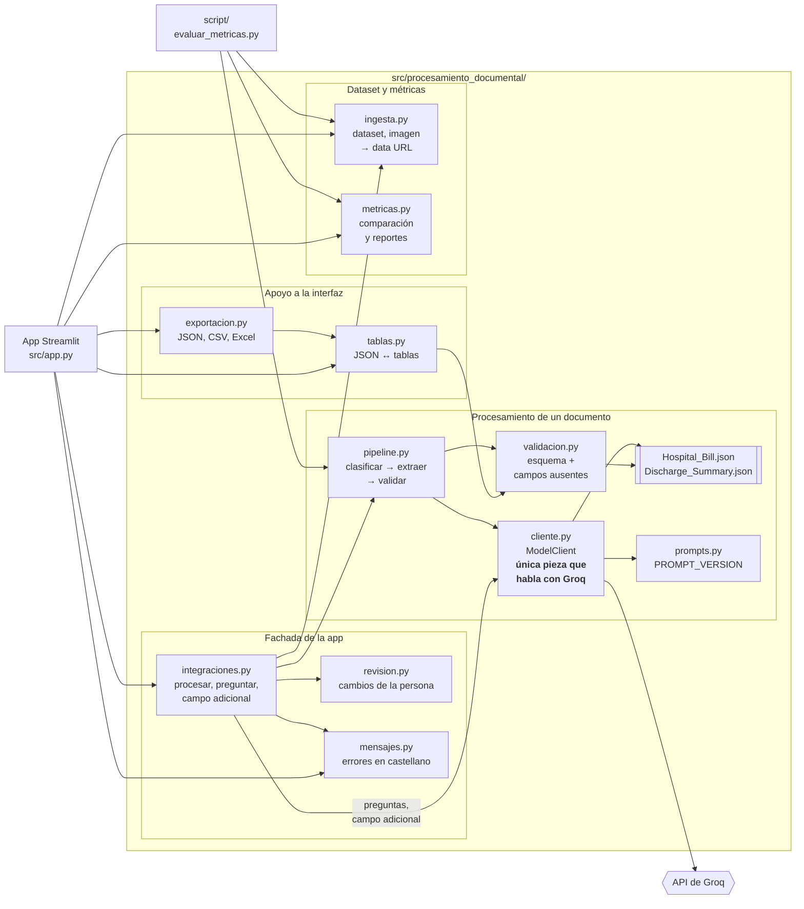

# ARCHITECTURE.md — Sistema de procesamiento documental mediante IA

Este documento describe las piezas del sistema, de qué se responsabiliza cada
una y cómo circula la información entre ellas. Las razones de cada elección
están en los ADRs de [`decisions/`](decisions/), y lo que hace cada
funcionalidad, en [`specs/`](specs/).

## Diagramas

La arquitectura se muestra en dos niveles, como en el
[modelo C4](https://c4model.com/): primero las piezas del sistema y lo que
intercambian, y después los módulos de `src/` y quién llama a quién. En los
dos, las flechas van de quien llama, usa, lee o escribe hacia lo llamado o lo
leído, y las etiquetas dicen qué viaja.

### Vista general

La persona usuaria solo trata con la app, y el equipo lanza la evaluación
aparte. La app y el script usan la misma lógica de `src/`, que es la única que
llama a Groq. También es `src/` quien localiza el dataset y lee la verdad de
referencia; la app solo lee del disco la imagen que se elige, con la ruta que
le da `ingesta.load_dataset()`. Nada se guarda en una base de datos: el estado
de cada documento vive en la sesión de Streamlit, y los reportes, en
`output/`.

### Componentes de `src/`

Solo `cliente.py` tiene una flecha hacia Groq: ni la app, ni el script, ni el
resto de módulos llaman a la API directamente. Los módulos se agrupan por
función: la fachada que usa la app, el procesamiento de un documento, el apoyo
a la edición y la exportación, y la lectura del dataset y las métricas. El
detalle de cada uno está en la tabla siguiente.

## Componentes

| Componente | Responsabilidad | Recibe | Produce |
|---|---|---|---|
| **App Streamlit** (`src/app.py`) | Solo la presentación. Carga la imagen, la muestra, lanza el procesamiento, enseña tipo, validación y entidades en tablas editables, deja marcar el resultado como validado, ofrece el chat, el campo adicional, las descargas y el último reporte de métricas. Lee `.env` al arrancar. | Imagen JPEG subida (solo `.jpg` y `.jpeg`, comprobado por el contenido con `ingesta.is_jpeg()`) o elegida del dataset, ediciones en tablas, preguntas. | Llamadas a `integraciones.py`, `tablas.py`, `exportacion.py`, `ingesta.py`, `mensajes.py` y `metricas.py`. Pantallas y descargas. |
| **Estado de sesión** (`st.session_state`) | Guarda por documento el resultado del modelo con sus campos adicionales (`document_results`), la revisión humana con el JSON corregido, la marca de validación y la copia del último JSON validado (`document_reviews`), y el historial del chat (`chat_histories`). No hay base de datos: todo vive solo durante la sesión. | Lo que escribe la app. | Lo que lee la app al repintarse. |
| **Integraciones** (`integraciones.py`) | Fachada entre la interfaz y la lógica. `procesar_documento()` convierte la imagen y llama a la tubería. `responder_pregunta()` y `extraer_campo_adicional()` llaman al cliente y comprueban la respuesta. Los fallos del procesamiento vuelven traducidos al castellano por `mensajes.py`; los de la consulta y el campo adicional salen como `ErrorProcesamiento` con la etapa y el texto del error, que puede incluir el original de Groq. | Bytes de la imagen, pregunta, historial, JSON validado. | `ResultadoProcesamiento` (tipo, entidades, validación, latencias, error) y `ResultadoPregunta` (respuesta, evidencias, cambios). |
| **Tubería** (`pipeline.py`) | Procesa un documento en serie: clasifica, extrae con el esquema del tipo y valida. Registra en qué etapa falla (`classification` o `extraction`). La usan la app y el script, así que los dos procesan igual. | `ModelClient` y la imagen como *data URL*. | `DocumentResult`. |
| **Cliente del modelo** (`cliente.py`) | La única pieza que habla con Groq. Lee `GROQ_API_KEY` y `GROQ_MODEL` del entorno, pide `json_object` con `temperature=0`, reintenta los fallos transitorios (hasta 5 intentos, respetando `retry-after`) y, si la respuesta no cumple el esquema, le devuelve al modelo sus errores para que la corrija (hasta 3 llamadas). Mide latencia y tokens. | Mensajes de `prompts.py` y el esquema que debe cumplir la respuesta. | `ModelResponse` (contenido, latencia, tokens, intentos) o `ModelError` (tipo de fallo, código HTTP, código de error de Groq y, si lo hay, el texto rechazado). |
| **Prompts** (`prompts.py`) | Construye las peticiones: clasificación (`bill`, `discharge_summary`), extracción con el esqueleto del esquema, preguntas y campo adicional. Fija `PROMPT_VERSION` para poder comparar evaluaciones. | Imagen, tipo documental, contexto JSON, pregunta. | Lista de mensajes y esquema de la respuesta. |
| **Esquemas** (`src/Hospital_Bill.json`, `src/Discharge_Summary.json`) | Definen los campos de cada tipo, con los mismos campos que la verdad limpia. Ver el [ADR de esquemas](decisions/esquemas-extraccion-documental.md). | — | JSON Schema Draft 2020-12. |
| **Validación** (`validacion.py`) | Comprueba que el JSON de extracción es válido según su esquema y lista los campos ausentes (`null` o lista vacía). | Tipo documental y texto JSON. | `ValidationResult` (válido, errores, campos ausentes, datos). |
| **Mensajes de error** (`mensajes.py`) | Traduce cada fallo, según su etapa, el código HTTP y el código de error de Groq, a qué ha pasado y qué hacer, en castellano. El texto técnico se conserva aparte. | Etapa, tipo de error, código HTTP y código de Groq. | `UserMessage`. |
| **Revisión** (`revision.py`) | Calcula qué campos cambió la persona respecto a lo que extrajo el modelo, para que el chat lo diga. Los cambios no se envían a Groq. | JSON del modelo y JSON validado. | Lista de `EntityChange`. |
| **Tablas** (`tablas.py`) | Convierte el JSON en las tablas que se editan en la app y las tablas editadas de vuelta a JSON, validándolo contra el esquema. | Tipo documental y JSON o tablas. | `DataFrame` por sección o JSON y su validación. |
| **Exportación** (`exportacion.py`) | Genera en memoria los ficheros de descarga del resultado corregido. | Nombre del documento, tipo, entidades editadas y marca de validación. | Bytes de `.json`, `.csv` y `.xlsx`. |
| **Ingesta** (`ingesta.py`) | Lee las imágenes de `data/raw/` con su verdad limpia de `data/processed/`, toma muestras equilibradas por tipo con semilla fija (el script usa 42) y convierte imágenes a *data URL*. | Rutas del dataset. | Lista de `Document` y *data URLs*. |
| **Métricas** (`metricas.py`) | Compara la extracción con la verdad limpia campo a campo, resume los reportes y localiza el último de `output/`. | JSON de referencia y predicho, CSV de `output/`. | `ExtractionMetrics`, `MetricsSummary`, `MetricsReport`. |
| **Evaluación** (`script/evaluar_metricas.py`) | Procesa una muestra del dataset con la misma tubería que la app, llamando a Groq una vez por documento. Guarda dos CSV e imprime un resumen con el coste estimado y si se cumplen los objetivos de calidad. | Muestra de `ingesta.py`, precios por millón de tokens. | `output/metricas_*.csv` y `output/prueba_modelo_*.csv`. |
| **Limpieza de la verdad** (`Notebooks/limpieza_datos.ipynb`) | Quita de la verdad original los campos que no se ven en las imágenes de su tipo. Se ejecuta una vez y cada vez que cambia un esquema. | CSV de `data/raw/`, que no se modifica. | CSV de `data/processed/`. |
| **API de Groq** (externa) | Ejecuta el modelo multimodal. | Mensajes con la imagen y el prompt. | Objeto JSON y uso de tokens, o un error HTTP. |

## Flujo entre componentes

### 1. Procesar un documento ([`prototipo-streamlit`](specs/prototipo-streamlit.md), [`validacion-extraccion`](specs/validacion-extraccion.md))

1. La persona sube una imagen o elige una del dataset. La app pasa sus bytes a
   `integraciones.procesar_documento()`.
2. Integraciones la convierte en *data URL* (`ingesta.image_to_data_url`) y
   llama a `pipeline.process_document()`.
3. La tubería pide al cliente la **clasificación**. El cliente envía a Groq la
   imagen con el prompt de `prompts.py` y recibe `{"document_type": ...}`.
4. Con el tipo, la tubería pide la **extracción**. El cliente envía la imagen
   con el esqueleto del esquema de ese tipo. Si la respuesta no cumple el
   esquema, le devuelve al modelo sus errores para que la corrija.
5. `validacion.py` comprueba el JSON final y lista los campos ausentes.
6. La app guarda el `ResultadoProcesamiento` en la sesión y lo muestra en
   tablas editables (`tablas.entities_to_tables`).
7. Si una llamada falla, el cliente lanza `ModelError` con el código HTTP y el
   código de error de Groq, y la tubería lo captura y anota en qué etapa
   ocurrió, sin propagar la excepción. Integraciones lo traduce con
   `mensajes.py`, y la app muestra ese mensaje en castellano y deja plegado el
   texto técnico.

### 2. Corregir, validar y exportar ([`edicion-exportacion`](specs/edicion-exportacion.md))

1. La persona edita las tablas. `tablas.tables_to_entities()` las devuelve a
   JSON y `tablas.validate_tables()` las valida con el mismo esquema.
2. «Marcar como validado» solo se activa si el JSON editado cumple el
   esquema. Al pulsarlo, la app guarda una copia en la sesión
   (`validated_entities`) como «último JSON validado», junto al original del
   modelo. Cualquier edición posterior quita la marca, pero la copia se
   conserva hasta la siguiente validación.
3. Las descargas llaman a `exportacion.to_json_bytes`, `to_csv_bytes` y
   `to_excel_bytes` con el JSON editado, esté o no validado. Solo se activan si
   cumple el esquema, y el JSON exportado indica en `validated_by_human` si lo
   validó una persona. Los ficheros se generan en memoria y no se guardan en el
   servidor.

### 3. Preguntar sobre el documento ([`consulta-documento`](specs/consulta-documento.md))

1. La app llama a `integraciones.responder_pregunta()` con la pregunta, el
   historial del chat de ese documento y el último JSON validado (o el del modelo si no hay
   ninguno validado).
2. `revision.entity_changes()` calcula qué cambió la persona. Esos cambios se
   quedan en Python: no se envían a Groq.
3. El cliente envía a Groq el JSON, la pregunta y los 10 últimos mensajes del
   historial, **sin la imagen**. Groq devuelve una intención y rutas JSON candidatas, no valores.
4. Integraciones comprueba que las rutas existen, lee sus valores del JSON y
   redacta la respuesta. Si usa un dato corregido, lo dice e indica lo que
   había extraído el modelo. Si la pregunta es ambigua o falta el dato, pide
   aclaración. Si la pregunta no trata del documento, la rechaza. El chat no
   calcula ni deduce valores.

**Campo adicional.** `extraer_campo_adicional()` sí vuelve a enviar la imagen a
Groq. El valor se guarda en `additional_fields`, separado de `entities`, para no
romper el esquema.

### 4. Evaluar el modelo ([`evaluacion-metricas`](specs/evaluacion-metricas.md))

1. `limpieza_datos.ipynb` genera la verdad limpia en `data/processed/` a partir
   de `data/raw/`.
2. `evaluar_metricas.py` toma una muestra con `ingesta.sample_documents()`
   (12 facturas y 12 informes, semilla 42) y procesa cada imagen con la misma
   `pipeline.process_document()` que la app.
3. `metricas.compare_extraction()` compara cada resultado con su verdad limpia.
   El script escribe en `output/` un CSV de métricas y otro de la prueba del
   modelo (clasificación, JSON válidos, latencias, tokens e intentos). Al
   terminar imprime el coste estimado y si se cumplen los objetivos de calidad:
   la clasificación acierta al menos el 95 %, los JSON válidos son al menos el
   90 % y la latencia p95 no pasa de 10 s.
4. La app lee el último reporte con `metricas.load_latest_metrics()` y lo
   muestra. No vuelve a evaluar.

## Decisiones que dan forma a la arquitectura

| ADR | Efecto en la arquitectura |
|---|---|
| [Inferencia con la API de Groq](decisions/modelo-via-api-groq.md) | El modelo es un servicio externo detrás de un único cliente. El esquema se valida en el cliente, no en Groq. |
| [Esquemas de extracción documental](decisions/esquemas-extraccion-documental.md) | Un esquema por tipo, que comparten cliente, validación, tablas, exportación y evaluación. Por eso existe la verdad limpia. |
| [Interfaz en Streamlit](decisions/interfaz-streamlit.md) | La app es una capa fina sobre `src/`, de modo que el script de evaluación ejecuta el mismo código. |
| [Validar el esquema en el cliente](decisions/validacion-esquema-en-cliente.md) | El cliente es el único punto donde se garantiza el esquema: pide `json_object`, valida y pide corregir. Por eso las tablas, la exportación y la evaluación pueden contar con sus claves. |
| [Consulta por rutas JSON](decisions/consulta-por-rutas-json.md) | La consulta no reenvía la imagen: Groq elige rutas, `integraciones.py` lee los valores y `revision.py` señala los datos corregidos. |
