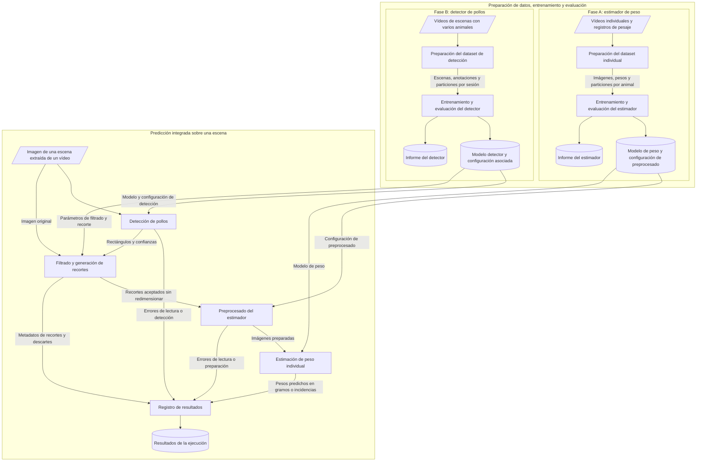

# Arquitectura de la solución

## 1. Alcance y estado actual

La solución se plantea como un piloto experimental para estimar el peso de pollos a partir de imágenes capturadas en Aviporto. La arquitectura conecta las tres funcionalidades definidas en las especificaciones: [preparación del dataset de imágenes y pesos](specs/preparacion-dataset-peso.md), [estimación de peso individual](specs/estimacion-peso-individual.md) y [extracción de pollos individuales](specs/extraccion-pollos-individuales.md).

El trabajo se organiza en dos fases de captura:

- **Fase A - Captura individual con peso de referencia.** Se pesan y graban los animales de uno en uno. Los vídeos y los registros manuales permiten construir un dataset de imágenes asociadas al identificador del animal y a su peso real en gramos, destinado al entrenamiento y la evaluación del estimador.
- **Fase B - Captura de escenas con varios animales.** Se obtienen imágenes que se anotarán para entrenar o adaptar y evaluar un detector. Durante la predicción, las detecciones aceptadas generan recortes individuales que se entregan al estimador de peso.

La primera versión realizará el procesamiento por lotes en un ordenador, después de copiar las grabaciones desde la microSD extraída de la cámara. El equipo ejecutará las etapas de preparación, entrenamiento, evaluación y predicción mediante scripts y notebooks, conservando los datos y resultados necesarios para revisar cada ejecución.

### Estado del proyecto

En el momento de redactar este documento, se han comprobado la grabación con la cámara, la recuperación de vídeos desde la microSD, la extracción de fotogramas y la detección de un marcador ArUco en pruebas fuera de la explotación. El marcador se utilizará como referencia auxiliar para documentar y comparar las condiciones de captura; no constituye una entrada obligatoria del estimador de peso.

La primera jornada en Aviporto está pendiente, por lo que todavía no se dispone del dataset propio ni se han entrenado o evaluado modelos con imágenes de la explotación. Este documento describe la arquitectura prevista. La selección final de modelos y la validación de su rendimiento quedan condicionadas a los datos que se obtengan.

## 2. Vista general de la arquitectura

La arquitectura distingue la preparación y el entrenamiento de los modelos de su utilización para generar predicciones. La fase A proporciona los datos para desarrollar el estimador de peso y la fase B proporciona las escenas para desarrollar el detector. Ambos modelos se combinan posteriormente para procesar escenas con varios animales.

El diagrama diferencia tres tipos de elementos:

- **Entradas (romboides):** datos que recibe el sistema.
- **Componentes de procesamiento (rectángulos):** operaciones que transforman los datos.
- **Artefactos (cilindros):** archivos generados que se conservan para su consulta o utilización posterior.

Las flechas indican qué información se intercambia. El equipo ejecuta las etapas mediante scripts y notebooks. Los componentes de procesamiento se describen en el apartado 3. Las entradas y los artefactos se detallan en el apartado de datos y trazabilidad.

Para mantener la legibilidad, los datasets intermedios se representan mediante las conexiones entre preparación y entrenamiento. Las imágenes, anotaciones, metadatos y particiones que contienen también se guardan para poder revisar y repetir los experimentos. Los cilindros representan archivos conservados; no implican utilizar una base de datos.

### Preparación de datos

La fase A proporciona vídeos individuales y registros que relacionan cada intervalo con un animal y su peso medido. La preparación del dataset comprende la extracción de fotogramas, la revisión de las imágenes, la generación de metadatos y la división en entrenamiento, validación y test. Todas las imágenes de un mismo animal permanecen en una única partición.

La fase B proporciona vídeos de escenas con varios animales. La preparación del dataset de detección comprende la extracción y selección de escenas, su anotación con un rectángulo por pollo visible y la división en entrenamiento, validación y test por sesión de captura. La anotación requiere intervención del equipo.

### Entrenamiento y evaluación

El estimador de peso y el detector se entrenan y evalúan por separado, utilizando sus respectivos datasets. Los modelos se entrenan con la partición de entrenamiento y se seleccionan utilizando validación. El conjunto de test se reserva para la evaluación final, una vez fijados el modelo y su configuración.

Cada proceso genera un modelo guardado, su configuración y un informe de evaluación. La configuración del estimador define el preprocesado que se aplicará de forma coherente durante entrenamiento, validación y predicción. La configuración asociada al detector incluye los parámetros de detección, filtrado y generación de recortes.

La evaluación del detector mide su precision y recall después del umbral de confianza y de la eliminación de duplicados, pero antes de los filtros de borde y solapamiento destinados a seleccionar recortes para el estimador.

### Predicción integrada

La predicción recibe una imagen de una escena, previamente extraída de un vídeo. Esta imagen no necesita estar anotada y se procesa con los modelos y configuraciones fijados durante el desarrollo.

El detector localiza los pollos y produce sus rectángulos y confianzas. A continuación, el componente de filtrado aplica el umbral de confianza, elimina las detecciones duplicadas y comprueba las reglas de borde y solapamiento definidas en la spec de extracción.

Cada detección aceptada genera un recorte a resolución original, sin redimensionar. El componente de preprocesado adapta ese recorte a la entrada del estimador, que produce una predicción de peso en gramos. La preparación de las imágenes de entrenamiento y de los recortes seguirá un criterio común de encuadre y tratamiento del fondo, que deberá concretarse antes de los experimentos de integración.

El registro de resultados vincula cada predicción con su recorte, detección e imagen de origen. También conserva las coordenadas, las confianzas, los motivos de descarte, las incidencias y las referencias a los modelos y configuraciones utilizados. Si no hay detecciones aceptadas, se devuelve una lista vacía de recortes y se continúa con las siguientes imágenes.

Aunque el diagrama representa el recorrido integrado, el estimador también puede utilizarse por separado con imágenes individuales, como las obtenidas durante la fase A. En ese caso, cada imagen entra directamente en el preprocesado del estimador.

## 3. Componentes de procesamiento

Este apartado describe los **rectángulos del diagrama**: los componentes que transforman los datos. Las entradas y los artefactos conservados se detallan en el apartado de datos y trazabilidad.

Cada componente representa una responsabilidad lógica. Su implementación podrá organizarse en funciones y scripts reutilizables, utilizando notebooks para ejecutar y analizar los experimentos.

### 3.1. Preparación de datos

| Componente | Entradas | Responsabilidad | Salidas |
| --- | --- | --- | --- |
| **Preparación del dataset individual** | Vídeos de fase A y registros con intervalos, identificadores de animales, sesiones y pesos medidos. | Validar los registros, extraer fotogramas con frecuencia configurable, facilitar su revisión manual y generar las particiones por animal. | Imágenes seleccionadas, CSV de etiquetas y procedencia, asignación a entrenamiento, validación y test, registro de descartes y resumen del dataset. |
| **Preparación del dataset de detección** | Vídeos de fase B e identificadores de las sesiones de captura. | Extraer y seleccionar escenas, facilitar su anotación manual con un rectángulo por pollo visible y generar las particiones por sesión. | Escenas seleccionadas, anotaciones de rectángulos, metadatos de procedencia y asignación a entrenamiento, validación y test. |

La preparación del dataset individual rechaza los registros sin una asociación inequívoca entre intervalo, animal y peso. También rechaza los pesos ausentes, no numéricos, nulos o negativos. La revisión manual excluye las imágenes no aprovechables y registra los motivos.

El CSV conserva, como mínimo, la ruta de cada imagen, el identificador del animal, el peso en gramos, la sesión, el vídeo de origen y el instante del fotograma. La partición agrupa todas las imágenes del mismo animal, incluso si aparece en varias sesiones y puede reconocerse de forma fiable. El peso corresponde al registrado en cada sesión.

La preparación del dataset de detección utiliza un criterio común de anotación para animales parcialmente visibles. Las escenas de una misma sesión permanecen en una única partición.

Ambos componentes conservan los vídeos originales sin modificaciones y guardan la asignación a los conjuntos para reutilizarla entre experimentos. La generación de las particiones utiliza proporciones y una semilla configurables. Si no hay suficientes grupos independientes para formar los tres conjuntos, se informa de la limitación.

### 3.2. Entrenamiento y evaluación

| Componente | Entradas | Responsabilidad | Salidas |
| --- | --- | --- | --- |
| **Entrenamiento y evaluación del estimador** | Imágenes individuales, pesos de referencia, particiones y configuración del experimento. | Entrenar modelos para predecir el peso en gramos, comparar alternativas mediante validación y evaluar el modelo seleccionado en test. | Modelo de peso guardado, configuración de preprocesado, predicciones de test e informe del estimador. |
| **Entrenamiento y evaluación del detector** | Escenas anotadas, particiones por sesión y configuración del experimento. | Entrenar o adaptar detectores, seleccionar el modelo y ajustar sus parámetros mediante validación. Evaluar en test con la configuración fijada. | Modelo detector guardado, configuración asociada e informe del detector. |

El informe del estimador incluye MAPE, MAE en gramos y número de imágenes y animales diferentes evaluados. El preprocesado se aplica de forma coherente en entrenamiento, validación y test; las posibles transformaciones de aumento de datos se restringen al entrenamiento.

El informe del detector incluye precision, recall, número de escenas de test, número de pollos anotados y recuentos de detecciones aceptadas y descartadas por cada regla. El emparejamiento con las anotaciones sigue el procedimiento definido en la spec de extracción, con IoU ≥ 0,5 y sin reutilizar una detección o anotación en varios emparejamientos.

Los modelos guardados incluyen la información necesaria para reconstruirlos y utilizarlos. El estimador conserva su configuración de preprocesado y el detector su configuración de entrada, confianza, eliminación de duplicados, filtrado y recorte. Los modelos y configuraciones se identifican para poder relacionarlos con sus informes y predicciones.

### 3.3. Predicción integrada

| Componente | Entradas | Responsabilidad | Salidas |
| --- | --- | --- | --- |
| **Detección de pollos** | Imagen de una escena, modelo detector y configuración de detección. | Preparar la entrada del detector, ejecutar el modelo y expresar sus rectángulos sobre la imagen original. | Detecciones con identificador, rectángulo y confianza, o error identificable si la imagen no puede procesarse. |
| **Filtrado y generación de recortes** | Imagen original, detecciones y parámetros de filtrado y recorte. | Filtrar por confianza, eliminar duplicados, comprobar borde y solapamiento y extraer los recortes aceptados. | Recortes sin redimensionar y metadatos de las detecciones, con su estado y motivos de descarte. |
| **Preprocesado del estimador** | Recorte aceptado o imagen individual y configuración de preprocesado. | Comprobar la lectura de la imagen y aplicar el redimensionado, tratamiento de proporciones y normalización definidos para el modelo. | Imagen preparada para el estimador o error identificable. |
| **Estimación de peso individual** | Imagen preparada y modelo de peso. | Ejecutar el modelo y comprobar que la salida sea numérica, finita y positiva. | Peso predicho en gramos asociado a la imagen de entrada o incidencia si la salida no es válida. |
| **Registro de resultados** | Metadatos de detecciones y recortes, predicciones, incidencias y referencias a modelos y configuraciones. | Reunir y guardar los resultados conservando su relación con la escena y la ejecución de origen. | Archivos de resultados con predicciones, descartes, errores y referencias a los recortes generados. |

El filtrado utiliza las coordenadas de detección en formato *(x_min, y_min, x_max, y_max)* sobre la imagen original. Conserva tanto estas coordenadas como las del recorte ampliado, limitado a los bordes de la imagen.

El solapamiento se calcula después del filtro de confianza y de la eliminación de duplicados. La decisión se obtiene para cada rectángulo antes de retirar los descartados, evitando que dependa del orden de procesamiento. Cuando corresponden varios motivos de descarte, todos quedan registrados.

Las reglas seleccionan recortes potencialmente aprovechables, pero no garantizan que los animales estén completos o libres de oclusiones. La compatibilidad entre estos recortes y las imágenes de entrenamiento se comprobará durante la integración.

Los errores identificables se trasladan al registro de resultados. Una incidencia en una imagen no interrumpe el procesamiento de las siguientes. Si una escena no genera recortes aceptados, se conserva su resultado vacío junto con los descartes correspondientes.

## 4. Datos, artefactos y trazabilidad

Los vídeos, imágenes, anotaciones, modelos y resultados se conservan como archivos. Los metadatos permiten relacionarlos sin depender únicamente de su nombre o ubicación. Cada sesión de captura, animal, imagen, detección y ejecución dispone de un identificador dentro del ámbito correspondiente.

### 4.1. Datos de entrada y datasets preparados

| Datos | Contenido y procedencia | Utilización |
| --- | --- | --- |
| **Vídeos individuales y registros de pesaje** | Grabaciones de fase A y registros que relacionan cada intervalo con un animal, una sesión y un peso medido en gramos. | Construcción del dataset del estimador. |
| **Vídeos de escenas con varios animales** | Grabaciones de fase B, identificadas por sesión y conservadas sin modificaciones. | Extracción de escenas para preparar el detector y probar la predicción integrada. |
| **Dataset individual** | Imágenes revisadas, CSV de etiquetas y procedencia, particiones por animal y registro de descartes. | Entrenamiento, validación y evaluación del estimador. |
| **Dataset de detección** | Escenas, rectángulos anotados, metadatos de procedencia y particiones por sesión. | Entrenamiento, validación y evaluación del detector. |
| **Imagen de una escena extraída de un vídeo** | Fotograma con identificador y referencia a su vídeo, sesión e instante de origen. No necesita anotaciones para generar predicciones. | Entrada de la predicción integrada. |

El CSV del dataset individual conserva los siguientes campos:

| Campo | Significado |
| --- | --- |
| `image_id` | Identificador único de la imagen. |
| `image_path` | Ruta del archivo de imagen. |
| `animal_id` | Identificador del animal utilizado para agrupar sus imágenes. |
| `weight_g` | Peso de referencia medido en la sesión, expresado en gramos. |
| `session_id` | Sesión de captura. |
| `video_id` | Vídeo de procedencia. |
| `timestamp_s` | Instante del fotograma respecto al inicio del vídeo, en segundos. |
| `split` | Asignación a entrenamiento, validación o test. |

El identificador del animal evita confundir ejemplares que reciban el mismo número local en jornadas distintas. Si un animal vuelve a grabarse y puede reconocerse de forma fiable, mantiene su identificador; el peso se registra por sesión.

Las anotaciones del detector conservan la clase y las coordenadas de cada rectángulo, asociadas a una escena identificada. El formato concreto se adaptará a las herramientas de entrenamiento elegidas, manteniendo la relación con la imagen original y su partición.

### 4.2. Modelos, configuraciones e informes

| Artefacto | Información conservada |
| --- | --- |
| **Modelo de peso y configuración de preprocesado** | Identificador del modelo, arquitectura, pesos aprendidos y transformaciones necesarias para preparar sus imágenes de entrada. |
| **Modelo detector y configuración asociada** | Identificador del modelo, arquitectura, pesos aprendidos, preparación de entrada y parámetros de confianza, eliminación de duplicados, borde, solapamiento y margen de recorte. |
| **Informe del estimador** | Dataset y particiones utilizados, configuración del experimento, métricas de test, predicciones frente a pesos de referencia y limitaciones observadas. |
| **Informe del detector** | Dataset y particiones utilizados, configuración del experimento, métricas de detección y recuentos de aceptación y descarte. |

Cada experimento registra la versión del dataset, las particiones, la configuración y las semillas utilizadas. Se conservarán también la versión del código y las dependencias necesarias para repetirlo. Las configuraciones se guardarán en archivos legibles y vinculados al identificador de la ejecución.

Los informes se asocian al modelo concreto que evalúan. Si se modifican el modelo, el preprocesado o los parámetros de filtrado, la nueva ejecución queda diferenciada de las anteriores.

### 4.3. Resultados de la ejecución

Los resultados de predicción conservan tres niveles de información:

| Nivel | Información mínima |
| --- | --- |
| **Escena** | Identificador de imagen, procedencia, identificador de ejecución y estado del procesamiento, incluso si no hay detecciones aceptadas. |
| **Detección y recorte** | Identificador de detección dentro de la escena, rectángulo original, confianza, estado, motivos de descarte y, si se acepta, ruta y coordenadas del recorte ampliado. |
| **Predicción de peso** | Referencia a la imagen o recorte procesado, identificador del modelo de peso y peso predicho en gramos, o incidencia si no se obtiene una salida válida. |

La combinación del identificador de escena y del identificador de detección permite localizar inequívocamente cada animal detectado dentro de esa imagen. No representa una identidad persistente del pollo entre fotogramas.

Los pesos medidos y los predichos se almacenan en campos diferenciados. Los recortes de fase B no reciben automáticamente una etiqueta de peso real. Para evaluar el error del sistema integrado será necesario disponer de una asociación independiente e inequívoca entre los animales de esas escenas y sus pesajes de referencia.

## 5. Decisiones relacionadas y aspectos pendientes

### Decisiones de implementación

Los ADRs desarrollan la motivación, las alternativas y las referencias prácticas de las siguientes decisiones:

| ADR | Relación con la arquitectura |
| --- | --- |
| [Entrenamiento con aprendizaje por transferencia](decisions/entrenamiento-con-transfer-learning.md) | Define el uso de modelos preentrenados adaptados a regresión para el estimador de peso. La arquitectura concreta se seleccionará mediante experimentos con entrenamiento y validación. |
| [Dataset trazable con metadatos CSV](decisions/dataset-trazable-con-metadatos-csv.md) | Define cómo relacionar las imágenes individuales con sus animales, pesos, sesiones y vídeos de origen, conservando la información necesaria para generar las particiones y repetir los experimentos. |

### Aspectos pendientes de validación

La arquitectura establece las responsabilidades y los intercambios entre componentes. Los siguientes aspectos se concretarán cuando se disponga de los datos de Aviporto:

- **Condiciones de captura:** confirmar el encuadre, la iluminación, la altura y el zoom de la cámara, y documentarlos por sesión.
- **Disponibilidad de datos:** comprobar que existen suficientes animales y sesiones independientes para crear las particiones de entrenamiento, validación y test. Si no es posible, documentar la limitación y acordar cómo ampliar la recogida.
- **Compatibilidad de las imágenes:** fijar un criterio común de encuadre y tratamiento del fondo para las imágenes individuales de entrenamiento y los recortes de escenas.
- **Modelos y parámetros:** comparar arquitecturas, concretar el preprocesado y ajustar los parámetros de entrenamiento, detección y filtrado utilizando validación.
- **Evaluación integrada:** determinar qué escenas podrán asociarse inequívocamente a pesajes de referencia para medir el error del sistema completo.
- **Objetivos de rendimiento:** revisar con los tutores y Aviporto las referencias iniciales de las specs y fijarlas antes de la evaluación final.

Las decisiones que cambien como resultado de estas comprobaciones se reflejarán en la arquitectura y en los ADRs correspondientes.
