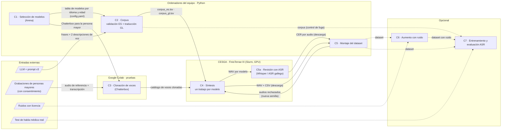

# Arquitectura

Este documento describe cómo construimos el sistema definido en las [specs](specs/): qué partes tiene, de qué se encarga cada una y qué ficheros se pasan entre ellas. Las decisiones principales están justificadas en los [ADR](decisions/).

## 1. Visión general

El sistema genera el dataset en una secuencia de pasos. Cada paso produce ficheros que usa el siguiente:

1. Elegimos los modelos de síntesis escuchándolos y votando (Arena).
2. Generamos las frases médicas en castellano con un LLM, las validamos con un script y las traducimos al gallego.
3. Clonamos voces de personas mayores a partir de grabaciones reales.
4. Sintetizamos las frases con los modelos elegidos y revisamos cada audio con un ASR.
5. Juntamos los audios, volvemos a sintetizar los defectuosos y montamos el dataset con sus metadatos.

Opcionalmente, después añadimos ruido al dataset y entrenamos un ASR con él.

**Dónde se ejecuta cada cosa.**

- **CESGA (FinisTerrae III, con Slurm):** la síntesis del dataset y la revisión con ASR, que necesitan muchas horas de GPU. Cada modelo es un trabajo de la cola con su propio script y su propio entorno ([ADR-003](decisions/003-sintesis-cesga-un-trabajo-por-modelo.md)).
- **Google Colab:** solo como entorno de pruebas (probar un modelo con pocas frases y escucharlo) y para la clonación de voces, que son trabajos cortos. Sus sesiones se cortan con facilidad, así que no se usa para generar el dataset.
- **Nuestros ordenadores:** el Arena (escucha y votación), la preparación del corpus y el montaje del dataset, que no necesitan GPU. Los audios generados en el CESGA se descargan a nuestros ordenadores para montar el dataset.

**Cómo se enlaza cada audio con su frase.** Cada frase tiene un identificador (`es_00001`…) que es el mismo en castellano y en gallego, y cada frase tiene 2 voces, así que un audio queda identificado por idioma + `id` + número de voz (1 o 2). El nombre del fichero lleva esos datos, y la transcripción se toma siempre del corpus por `id`, nunca del orden de las frases.

## 2. Diagrama

Las flechas continuas son el flujo principal; las discontinuas, las partes opcionales (specs 06 y 07). Los paralelogramos son datos que vienen de fuera del sistema. Los recuadros agrupan los componentes según dónde se ejecutan.

## 3. Componentes

### C1 · Selección de modelos (spec 01)

| | |
| --- | --- |
| **Qué hace** | Compara los modelos candidatos escuchando las mismas frases de prueba y votando por parejas, y fija qué modelo se usa para cada idioma y franja de edad. |
| **Entrada** | Los modelos candidatos de Balidea y las frases de prueba en castellano y en gallego (las mismas para todos los modelos). |
| **Salida** | Los audios de prueba, los votos y la clasificación (`ranking_general.csv`, `ranking_por_perfil.csv`), y la tabla de modelos por idioma y franja de edad (sección `modelos` de `codigo/corpus/config.yaml`, [ADR-005](decisions/005-modelos-por-perfil.md)). |
| **Resultado** | En castellano ganó OmniVoice en los cuatro perfiles. Usamos OmniVoice, NOS (voz adulta), supertonic 3 (una parte pequeña de la voz adulta) y Chatterbox Multilingual V3 (persona mayor, por clonación). En gallego solo OmniVoice y NOS suenan a gallego de verdad, así que usamos esos dos. |

### C2 · Corpus en castellano y traducción al gallego (specs 02 y 03)

| | |
| --- | --- |
| **Qué hace** | Convierte las frases que genera el LLM en un corpus limpio y validado, le asigna a cada voz un modelo y lo traduce al gallego. |
| **Entrada** | Un fichero con las 2.000 frases generadas por el LLM con el prompt [`prompts/generacion-textos-medicos-es.md`](prompts/generacion-textos-medicos-es.md), cada una con 2 descripciones de voz ([ADR-001](decisions/001-corpus-generado-con-llm.md)), y la tabla de modelos de C1. |
| **Salida** | `corpus_es.tsv` y `corpus_gl.tsv`, con las columnas `id · frase · prompts_voz · modelo · fuente`. Junto a cada corpus quedan las frases descartadas con su motivo (`descartes.tsv`), un informe de validación y un `manifest.json` con la configuración y las versiones usadas. |
| **Cómo** | El script [`codigo/corpus/corpus.py`](codigo/corpus/README.md) valida el castellano: sin dígitos ni siglas, de 3 a 30 palabras, sin duplicados y 2 voces válidas por frase. Después asigna el modelo de cada voz según su franja de edad. Para el gallego, el mismo script traduce con **NOS-MT-OpenNMT-es-gl** de Proxecto Nós ([ADR-002](decisions/002-traduccion-nos-mt.md)), vuelve a validar y cambia en las descripciones de voz el idioma. El `id` de cada frase es el mismo en los dos corpus. La fuga hacia el test no se comprueba aquí, porque el test real todavía no existe: la hace C7 (spec 07, paso 1). |
| **Estado** | Hecho: 2.000 frases en castellano (ninguna descartada) y 1.736 en gallego (264 descartadas). Queda la revisión manual de la muestra de 100 traducciones (`muestra_revision.tsv`). |

### C3 · Clonación de voces (spec 04)

| | |
| --- | --- |
| **Qué hace** | Crea voces de persona mayor con Chatterbox Multilingual V3 a partir de grabaciones reales, porque ningún modelo genera bien esa voz a partir de una descripción. |
| **Entrada** | Grabaciones de personas mayores en castellano y en gallego, con su transcripción y su consentimiento (sección 6). |
| **Salida** | Un catálogo de voces clonadas con su idioma, su perfil (hombre o mujer), la grabación de referencia (por un identificador interno) y los parámetros de clonación. |
| **Cómo** | Se clona una voz por grabación en Colab y el equipo las escucha; se quedan las que suenan a persona mayor y no tienen fallos. Si salen bien en castellano, se usa también Chatterbox para la persona mayor en gallego ([ADR-006](decisions/006-chatterbox-mayor-gallego.md)); si no, ese perfil sigue con OmniVoice. |
| **Estado** | Las grabaciones y los consentimientos ya están conseguidos; la clonación está pendiente. |

### C4 · Síntesis (spec 05)

| | |
| --- | --- |
| **Qué hace** | Genera un audio por cada voz de cada frase, con el modelo que indica la columna `modelo` del corpus. |
| **Entrada** | `corpus_es.tsv`, `corpus_gl.tsv` y, para Chatterbox, el catálogo de voces clonadas de C3. En una segunda pasada, los audios rechazados por C5. |
| **Salida** | Por cada modelo, los WAV y un CSV con una fila por audio: nombre del fichero, `id` de la frase, número de voz, idioma, modelo y versión, voz usada, semilla y duración. |
| **Cómo** | Un trabajo de Slurm en el FinisTerrae III por modelo (OmniVoice, NOS, supertonic y Chatterbox), cada uno con su script y su entorno ([ADR-003](decisions/003-sintesis-cesga-un-trabajo-por-modelo.md)). Cada script lee el corpus y sintetiza solo las voces que tienen asignado su modelo. Los modelos que aceptan descripciones reciben la descripción completa, con el estilo; los que no (NOS y supertonic) usan una voz fija del mismo sexo y una velocidad según el estilo. |
| **Estado** | Pendiente. |

### C5a · Revisión con ASR (spec 05)

| | |
| --- | --- |
| **Qué hace** | Transcribe cada audio sintetizado con un ASR y calcula su CER frente a la frase del corpus, para detectar audios que no dicen lo que pone su transcripción (palabras omitidas, repetidas o cortadas), como pide el control de calidad de la spec 05. |
| **Entrada** | Los WAV de un modelo (salida de C4) y el corpus de su idioma. |
| **Salida** | El CER de cada audio. |
| **Cómo** | Un trabajo en el CESGA al terminar la síntesis de cada modelo, porque transcribir miles de audios necesita GPU. Usa Whisper large-v3 en castellano y un ASR ajustado al gallego en gallego. |
| **Estado** | Pendiente. |

### C5 · Montaje del dataset (spec 05)

| | |
| --- | --- |
| **Qué hace** | Junta los audios y los CSV de todos los modelos, los convierte a un formato común, descarta los defectuosos y escribe el dataset con un único fichero de metadatos. |
| **Entrada** | Los audios y los CSV de C4, el CER de cada audio de C5a y los dos corpus. |
| **Salida** | El dataset con el formato del [ADR-004](decisions/004-formato-dataset.md): `audio/es/` y `audio/gl/` en WAV mono a 16 kHz, `metadata.csv` con una fila por audio y su transcripción, la lista de audios descartados, un resumen con las horas por idioma, perfil, estilo y modelo, y la configuración con la que se generó. |
| **Cómo** | Un script local que comprueba que cada voz del corpus tiene su audio, convierte todo al mismo formato, descarta los audios con un CER alto o con duraciones, silencios o saturación anómalos (spec 05), devuelve a C4 los rechazados para sintetizarlos con otra semilla y copia la transcripción del corpus por `id`. |
| **Estado** | Pendiente. |

### C6 · Aumento con ruido (spec 06, opcional)

| | |
| --- | --- |
| **Qué hace** | Crea una copia del dataset con ruido de fondo y eco, sin tocar el original. |
| **Entrada** | El dataset de C5 y una colección de ruidos con licencia que permita este uso. |
| **Salida** | Un dataset con el mismo formato, más columnas con el ruido aplicado, su intensidad y el audio original. |
| **Estado** | Por estudiar si es viable, sobre todo si se consiguen ruidos de hospital con una licencia adecuada. |

### C7 · Entrenamiento y evaluación ASR (spec 07, opcional)

| | |
| --- | --- |
| **Qué hace** | Comprueba si el dataset mejora un ASR sobre habla médica real. |
| **Entrada** | El dataset (con o sin ruido), los dos corpus (para el control de fuga) y un conjunto de test de habla médica real, en castellano y en gallego. |
| **Salida** | WER y CER de cada modelo entrenado y de la línea base (el ASR sin entrenar), por idioma. |
| **Cómo** | Primero se comprueba que ninguna frase del test está en los corpus, ni igual ni casi igual. Después se mide la línea base, se entrena con el dataset y se vuelve a medir, cambiando un solo factor en cada experimento. Entrenamiento y validación se separan por `id` de frase, para que una frase y sus voces no queden a los dos lados. |

## 4. Flujo de principio a fin

| Paso | Componente | Dónde | Lee | Produce |
| --- | --- | --- | --- | --- |
| 1 | C1 | Colab + local | Modelos candidatos, frases de prueba | Votos, clasificación, tabla de modelos por idioma y edad |
| 2 | C2 | Local | Frases del LLM, tabla de modelos | `corpus_es.tsv` |
| 3 | C2 | Local | `corpus_es.tsv` | `corpus_gl.tsv` |
| 4 | C3 | Colab | Grabaciones de personas mayores | Catálogo de voces clonadas |
| 5 | C4 | CESGA | Corpus y voces clonadas | WAV + CSV por modelo |
| 6 | C5a | CESGA | WAV de cada modelo y corpus | CER por audio |
| 7 | C5 | Local | WAV, CSV, CER y corpus (descargados) | Audios aceptados y rechazados; los rechazados vuelven al paso 5 con otra semilla |
| 8 | C5 | Local | Audios aceptados y corpus | Dataset: audios, `metadata.csv`, descartes, resumen y configuración |
| 9 | C6 (opc.) | — | Dataset y ruidos | Dataset con ruido |
| 10 | C7 (opc.) | — | Dataset, corpus y test real | Control de fuga; WER y CER frente a la línea base |

El paso 1 y los pasos 2–3 son independientes y pueden hacerse a la vez, salvo la columna `modelo` del corpus, que necesita la tabla de C1. El paso 4 tampoco depende del corpus, pero tiene que terminar antes de sintetizar la persona mayor en el paso 5.

## 5. Correspondencia con las specs

| Spec | Componente | Cómo se comprueba que se cumple |
| --- | --- | --- |
| 01 Selección de modelos | C1 | Votos y clasificación guardados; tabla de modelos en el ADR-005 |
| 02 Corpus en castellano | C2 | Informe de validación del script |
| 03 Traducción al gallego | C2 | Informe de validación y sistema de traducción con su versión en el `manifest.json` |
| 04 Voces | C3 | Catálogo de voces clonadas, con al menos una de hombre y otra de mujer de persona mayor |
| 05 Dataset | C4, C5a, C5 | Resumen del dataset: horas por idioma, cada voz del corpus con audio o descarte, mismo formato en todos los audios, ningún audio por encima de los umbrales de calidad |
| 06 Ruido (opc.) | C6 | Original sin cambios y misma transcripción en la copia con ruido |
| 07 ASR (opc.) | C7 | Control de fuga a 0, línea base y diferencia de WER de cada modelo entrenado |

## 6. Privacidad y consentimientos

Las grabaciones de personas mayores son datos personales: una voz identifica a quien habla. Por eso:

- Las grabaciones y los consentimientos se guardan fuera del repositorio, con acceso solo para el equipo.
- Cada grabación tiene un identificador interno (`ref_es_m01`…). En el código y en el dataset solo aparecen esos identificadores, nunca nombres.
- Solo usamos una grabación si su consentimiento permite clonar la voz y usar el audio generado para entrenar un ASR en un dataset que recibirá Balidea.
- Si alguien retira su consentimiento, quitamos su voz y generamos el dataset de nuevo sin sus audios.
- El dataset solo contiene audio sintético. Las grabaciones originales no se publican.

## 7. Riesgos y puntos abiertos

1. **Volumen del dataset.** Las frases del corpus son más cortas de lo que habíamos previsto (mediana de 8 palabras). Con 2 voces por frase, calculamos unas 3,5–4 h en castellano y unas 3 h en gallego, por debajo de las 5 h por idioma que pide la spec 05. Habrá que sintetizar más voces por frase, réplicas o generar más frases. Lo confirmaremos con las duraciones reales de los primeros audios.
2. **Calidad de la traducción al gallego.** De las 2.000 frases, 264 se descartaron (casi todas porque el traductor dejó palabras sin traducir, marcadas como `<unk>`) y 75 salieron iguales que en castellano, es decir, sin traducir. También hay traducciones erróneas: «Me mareo cuando me levanto de la cama» salió como «Érgome cando me mareo da tixola». Hay que hacer la revisión manual de la muestra de 100 frases y revisar cómo se llama al traductor, porque tantos `<unk>` apuntan a un problema en la preparación del texto.
3. **Gallego con pocos modelos.** Solo OmniVoice y NOS hablan gallego bien. NOS tiene dos voces (hombre y mujer) y lleva el 75 % de la voz adulta en gallego, así que ese perfil tendrá muy pocos hablantes distintos.
4. **Chatterbox en gallego.** Chatterbox no admite oficialmente el gallego, así que la persona mayor gallega puede sonar a castellano o a portugués. Lo vigilamos con los descartes de C5 para ese perfil.
5. **Licencia de OmniVoice.** Según el texto de su ficha, los pesos son de uso no comercial (CC-BY-NC), aunque los metadatos de la ficha indican Apache 2.0. El equipo tiene autorización para este uso, y hay que guardarla por escrito.
6. **supertonic sin mantenimiento.** El proyecto abierto está cerrado, así que guardamos una copia de los pesos que usamos.
7. **Audios repartidos entre ordenadores.** Como cada integrante descarga del CESGA los audios de los trabajos que ha lanzado, es fácil que falten ficheros o que haya versiones mezcladas. El montaje (C5) comprueba que cada voz del corpus tiene exactamente un audio antes de seguir.
8. **Cola del CESGA.** Los trabajos esperan en cola y se cortan al agotar el tiempo pedido, así que hay que contar con la espera al planificar, sobre todo para volver a sintetizar los audios rechazados.
9. **Test real.** Todavía no hay un conjunto de habla médica real en gallego, y sin él no se puede hacer la evaluación de la spec 07 en ese idioma.
10. **Validación de los perfiles por escucha.** Que cada perfil suene a su edad lo ha valorado el equipo escuchando, sin una prueba a ciegas ni un umbral fijado de antemano. Es una valoración, no un resultado medido. El único control objetivo durante la generación es el CER por perfil y modelo de C5a.
11. **Revisiones de los modelos sin fijar.** En `codigo/corpus/config.yaml` las revisiones de los cuatro modelos TTS están todavía como `por_fijar`, y el repositorio de NOS como `por_registrar`. Hay que fijarlas antes de empezar la síntesis (ADR-003).
