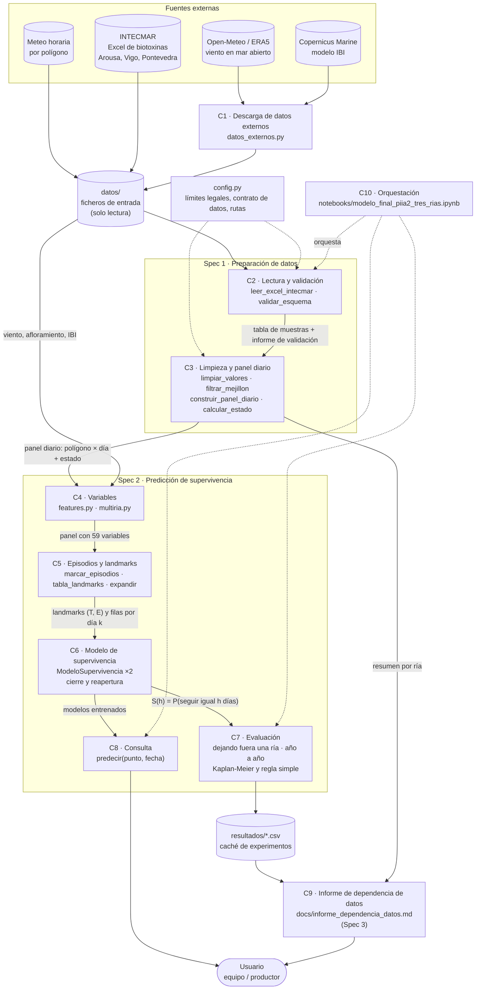
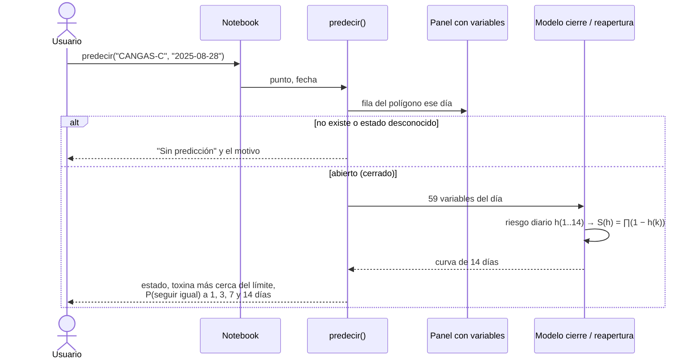

# Arquitectura

Aquí explicamos cómo está montado el sistema por dentro: qué piezas tiene, qué hace cada una y por
dónde pasan los datos desde que llega un Excel de INTECMAR hasta que sale una probabilidad de cierre.
Lo que tiene que hacer cada parte está en las [specs](specs/) y el porqué de las decisiones más
importantes, en [decisions/](decisions/).

El código está en nuestro repositorio, en la carpeta `modelo_piia2/`. Cuando ponemos rutas como
`bateas/datos.py` o `notebooks/...` son relativas a esa carpeta.

## Idea general

No hay servidor ni base de datos. Es un paquete de Python (`bateas/`) con toda la lógica y unos
notebooks que lo van llamando y enseñan los resultados. Los datos de entrada son ficheros dentro de
`datos/` y los experimentos que tardan mucho se guardan en CSV en `resultados/` para no repetirlos.

Se usa de dos formas:

- Entrenar y evaluar: de los Excel al modelo, las métricas y el informe de dependencia de datos.
- Consultar: `predecir(punto, fecha)` dice la probabilidad de que un polígono siga abierto (o
  cerrado) dentro de 1, 3, 7 y 14 días.

## Diagrama



Las flechas continuas son datos y las discontinuas, configuración o llamadas desde el notebook.

## Componentes

**C1. Descarga de datos externos** (`bateas/datos_externos.py`, `notebooks/descargar_datos_externos.ipynb`).
Pide a Open-Meteo el viento en mar abierto y calcula con él el índice de afloramiento (fórmula de
Bakun). De Copernicus baja el modelo IBI y lo lleva a cada polígono haciendo la media de las 4 celdas
de mar más cercanas. Solo se ejecuta una vez: deja los CSV en `datos/mar/` y `datos/copernicus/`, y a
partir de ahí el resto del sistema los lee de ahí.

**Carpeta `datos/` y `config.py`.** En `datos/` están todos los ficheros de entrada, cada fuente en su
subcarpeta (`rias/`, `meteorologia/`, `mar/`, `copernicus/`, `poligonos/`), y nunca se modifican.
`config.py` guarda lo que depende de la toxina o de la ría: los límites legales, las columnas
obligatorias, los 28 días de vigencia de una analítica, el horizonte de 14 días y las rutas. La idea
es que añadir una ría no obligue a tocar la lógica.

**C2. Lectura y validación** (`bateas/datos.py`, `scripts/validar_datos.py`, `multiria.unir_rias`).
Lee los Excel de INTECMAR tal cual vienen, arregla los nombres de columna (traen espacios raros) y
junta las rías en una sola tabla. El validador comprueba que estén `Punto`, `Fecha`, `Ria`, `Especie`
y al menos una toxina; si falta alguna se para y dice cuál. Si falta algo opcional solo avisa.

**C3. Limpieza y panel diario** (`limpiar_valores`, `parsear_toxina`, `construir_panel_diario` y
`calcular_estado` en `bateas/datos.py`; `filtrar_mejillon` y `resumen_rias` en `bateas/multiria.py`).
Quita los `-9999`, convierte `< LQ` en 0 y se queda con 159,1 de un `159,1 ±32,6`. Deja solo el
mejillón, toma el máximo de cada toxina por polígono y día, añade los días sin muestra y calcula el
estado de cada día: cerrado si alguna toxina vigente llega a su límite, abierto si no, y desconocido
si hace más de 28 días que no hay analítica. Lo que sale es el panel diario (una fila por polígono y
día) y un resumen de cada ría con sus cierres y si se puede evaluar por separado.

**C4. Variables** (`bateas/features.py` y `bateas/multiria.py`). Sobre el panel calcula las 59
variables del modelo, todas con información que ya se conocía ese día. Las toxinas van divididas por
su límite legal y no hay nada que identifique al polígono, para que el modelo sirva en una ría que no
ha visto ([ADR](decisions/variables-transferibles-entre-rias.md)). Las variables de las otras rías se
recalculan en cada evaluación solo con las rías de entrenamiento.

**C5. Episodios y landmarks** (`marcar_episodios`, `tabla_landmarks` y `expandir` en
`bateas/supervivencia.py`). Parte la historia de cada polígono en "vidas": abierto hasta que cierra,
cerrado hasta que reabre. Cada día de una vida es una foto (landmark) con la duración que le quedaba
`T` y si llegó a cambiar `E`. Después cada foto se convierte en una fila por día *k* (hasta 14), que es
lo que necesita el clasificador.

**C6. Modelo de supervivencia** (`ModeloSupervivencia` en `bateas/supervivencia.py`). Un gradient
boosting de scikit-learn que aprende el riesgo de cambiar el día *k*. Multiplicando (1 − riesgo) día a
día sale la probabilidad de seguir igual. Entrenamos dos con el mismo método, uno para el cierre y
otro para la reapertura ([ADR](decisions/modelo-supervivencia-tiempo-discreto.md)).

**C7. Evaluación** (`evaluar_dejando_fuera_ria`, `evaluar_por_anios` e `intervalo_mejora` en
`bateas/multiria.py`; `evaluar` y `kaplan_meier` en `bateas/supervivencia.py`). Entrena sin la ría que
evalúa y con datos anteriores al periodo evaluado. Saca AUC, Brier, F1 y los intervalos de confianza,
y compara siempre con Kaplan-Meier y con la regla simple ([ADR](decisions/evaluacion-ria-no-vista.md)).
También hace la ablación: quitar una fuente y ver cuánto empeora. Todo se guarda en `resultados/`
porque calcularlo desde cero tarda unas dos horas; desde la caché, un par de minutos.

**C8. Consulta** (`entrenar_sin_ria` y `predecir` en `bateas/multiria.py`). Recibe un polígono y una
fecha, mira si ese día estaba abierto o cerrado y usa el modelo que toca. Devuelve el estado, la
toxina más cerca de su límite y las cuatro probabilidades, o "sin predicción" y el motivo si el
polígono no existe o su estado es desconocido.

**C9. Informe de dependencia de datos** (`docs/informe_dependencia_datos.md`). No calcula nada: recoge
la ablación de `resultados/ablacion_anios.csv` y el resumen por ría de C3, clasifica cada fuente y
dice qué necesita una ría nueva.

**C10. Orquestación** (`notebooks/modelo_final_piia2_tres_rias.ipynb`). Va llamando a C2-C8 en orden
y enseña tablas y gráficos. No tiene lógica propia: todo lo que hace está en `bateas/`.

Además hay 15 tests en `tests/` con datos de juguete. El que más nos importa es
`test_sin_fuga_de_informacion`, que comprueba que cambiar datos a partir de una fecha no cambia
ninguna variable de los días anteriores.

## Flujo de entrenamiento y evaluación

1. Los Excel de INTECMAR (`datos/rias/<ría>.xlsx`) y la meteo por polígono los ponemos nosotros en
   `datos/`. El viento en mar abierto y Copernicus los baja C1 una vez.
2. Antes de meter una ría nueva se pasa `scripts/validar_datos.py` sobre su Excel. Si está bien,
   `unir_rias` junta los tres Excel en `datos/dataset_tres_rias.csv` (29.889 filas).
3. C3 construye el panel diario: 175.645 días-polígono de 45 polígonos, con el estado de cada día.
4. C4 añade las variables de los 9 grupos: toxinas propias, contexto de la ría, historial,
   estacionalidad, vecinos, otras rías, meteo por polígono, afloramiento y fitoplancton del IBI. Las de
   Copernicus van con un día de retraso.
5. C5 corta el panel en vidas, saca las fotos y las expande a filas por día.
6. C6 entrena el modelo de cierre con las fotos de polígonos abiertos y el de reapertura con las de
   cerrados.
7. C7 evalúa de dos maneras. Año a año (2018-2025, 24 pruebas), que es la que usamos para decidir, y
   una prueba estricta (entrenar hasta 2021 y evaluar 2022-2025), que es el resultado que damos.
8. Con la ablación y el resumen de C3 se escribe el informe de dependencia de datos (C9).

## Flujo de una consulta



Un ejemplo de verdad, con el modelo entrenado sin Vigo y preguntando por un polígono de Vigo:

```
Polígono: CANGAS-C | Fecha: 28/08/2025 | Estado: ABIERTO
Toxina más cerca del límite: ASP, 3.8 mg/kg (19% del límite)
   P(seguir abierto  1 días) =  99.8%
   P(seguir abierto  3 días) =  99.8%
   P(seguir abierto  7 días) =  98.5%
   P(seguir abierto 14 días) =  96.1%
```

(Cerró 7 días después. Es justo el tipo de cierre que no se puede ver venir: la analítica anterior
estaba al 19 % del límite.)

## Qué se pasan los componentes

| De → a | Qué | Columnas importantes |
|---|---|---|
| C2 → C3 | Tabla de muestras, una fila por muestra y profundidad | `punto`, `fecha`, `ria`, `zona`, `especie`, toxinas en bruto |
| C3 → C4 | Panel diario, una fila por polígono y día | `punto`, `fecha`, `ria`, `zona`, toxinas, `AO_frac`…, `frac_limite`, `cerrado` (0, 1 o vacío), `hay_muestra` |
| C4 → C5 | Panel con variables y el diccionario `grupos` (fuente → columnas) | `grupos` es lo que permite quitar una fuente entera en la ablación |
| C5 → C6 | Fotos y filas por día | `T`, `E`, `k`, `dow_obj`, `dias_muestra_obj` y la etiqueta, que vale 1 solo el día del cambio |
| C6 → C7 y C8 | Curva de supervivencia | Matriz de *n* × 14 con la probabilidad de seguir igual cada día |
| C7 → C9 | Métricas de la ablación | `resultados/ablacion_anios.csv`: año, ría, configuración y AUC a 7 días |

Variables que salen de C4 y C5 (62 en total):

| Grupo | Nº | Dónde se calcula | Ejemplos |
|---|---|---|---|
| Toxinas propias | 15 | `features.py` | `AO_frac`, `AO_pendiente`, `AO_max30`, `frac_limite`, `dias_desde_muestra` (y lo mismo con PSP y ASP) |
| Contexto de la ría | 4 | `features.py` | `ctx_max_7d`, `ctx_prop_cerrados` |
| Historial | 2 | `supervivencia.marcar_episodios` | `edad_episodio`, `cierres_365d` |
| Estacionalidad | 2 | `features.py` | `doy_sin`, `doy_cos` |
| Polígonos vecinos | 10 | `multiria.anadir_vecinos` | `vz_prop_cerrados` (misma zona), `vc_frac_max` (zonas de al lado) |
| Otras rías | 3 | `multiria.tabla_otras_rias` | `otras_prop_cerrados`, `otras_prop_alerta` |
| Viento y temperatura por polígono | 12 | `multiria.anadir_meteo_poligono` | `mp_viento_N_7d`, `mp_temp_7d` |
| Índice de afloramiento | 6 | `multiria.anadir_datos_externos` | `ia_7d`, `ia_dias_afloramiento_30d` |
| Fitoplancton y nitrato (IBI) | 5 | `multiria.anadir_datos_externos` | `bgc_fito_7d`, `bgc_no3_cambio_7d` |
| Calendario (del método) | 3 | `supervivencia.expandir` | `k`, `dow_obj`, `dias_muestra_obj` |

Solo aparecen PSP, ASP y AO. AZA y YTX no llegan nunca al límite y el propio código las descarta.

## Reglas que tiene que cumplir todo

- Nada del futuro: cada variable usa solo lo que se sabía ese día, y entre entrenamiento y
  evaluación dejamos siempre un hueco de 14 días.
- Nada que identifique al polígono o dónde está. La zona solo sirve para saber quiénes son sus
  vecinos.
- Meter una ría nueva no debería pedir cambios en el código: su Excel en `datos/rias/` y su ruta en la
  primera celda del notebook.
- Los datos originales no se tocan. Lo que se genera va a `datos/dataset_tres_rias.csv` o a
  `resultados/`.
- Un solo modelo de cierre y uno de reapertura para todas las rías.

## Relación con las specs

La [preparación de datos](specs/preparacion-datos-multi-ria.md) son C2 y C3. La
[predicción de supervivencia](specs/prediccion-supervivencia.md) va de C4 a C8. El
[informe de dependencia de datos](specs/informe-dependencia-datos.md) es C9, que tira de C3 y C7.

Hay dos cosas que no salieron como pusimos en la entrega 1:

- Usamos más fuentes de datos de las que pensábamos (vecinos, otras rías, calendario, meteo por
  polígono, afloramiento y fitoplancton). Lo explicamos en el
  [ADR de ampliación de fuentes](decisions/ampliacion-fuentes-de-datos.md).
- La spec 1 dice que el panel y el informe de validación se guardan como `panel_diario.csv` e
  `informe_validacion.txt`. De momento el panel se queda en memoria dentro del notebook y el informe
  sale por pantalla con `scripts/validar_datos.py`. Nos falta guardarlos en disco, pero no cambia
  nada del diseño.

## Decisiones

- [Modelo de supervivencia en tiempo discreto](decisions/modelo-supervivencia-tiempo-discreto.md)
- [Evaluación en una ría que el modelo no ha visto](decisions/evaluacion-ria-no-vista.md)
- [Variables que sirvan en cualquier ría](decisions/variables-transferibles-entre-rias.md)
- [Ampliación de las fuentes de datos](decisions/ampliacion-fuentes-de-datos.md)
