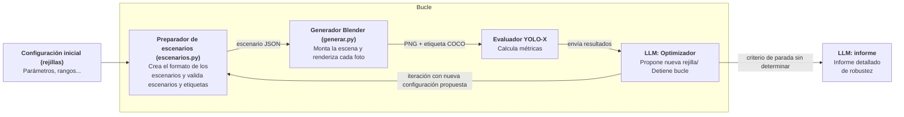

# ARCHITECTURE 
Mapa de solución: este documento muestra las piezas que componen el proyecto y cómo se conectan.

## Diagrama de arquitectura:

## Descripción de los componentes

- **Configuración inicial (rejilla)**: Un json de entrada creado por el usuario con tipos y rangos de los parámetros propuestos (fog_density, rain_particles, sun_energy, distance_m, heading_rad...) que define qué se prueba inicialmente. Esta rejilla genera las primeras configuraciones. 

**Responsabilidad**: entrada de datos. Recoger las decisiones del usuario y dar la configuración inicial.
- **Preparador de escenarios**: Define el formato común de los escenarios y etiquetas. Crea un escenario JSON por foto a partir de la rejilla, valida escenarios y etiquetas (campos, tipos, rangos y coherencia del *scenario_id*) y permite dibujar las bounding boxes sobre las imágenes para comprobar que el etiquetado es correcto.

**Responsabilidad**: construcción y validación de datos.
- **Generador Blender**: Monta la escena, específica de cada escenario JSON, renderiza una foto por escenario y calcula su etiqueta COCO proyectando todos los vértices de la aeronave 3D. Las 3 escenas (mar, campo o montaña) cumplen el mismo formato, por lo que son intercambiables.

**Responsabilidad**: simulación. Producir las imágenes sintéticas y su ground truth.
- **Evaluador YOLO-X**: Ejecuta el detector de Gradiant sobre las fotos y calcula las métricas contra el ground truth COCO. El modelo y el procedimiento de evaluación no cambian, las diferencias de métricas entre configuraciones se deben a las condiciones del escenario. Las comparaciones son válidas dentro de una misma escena y con un número suficiente de imágenes por grupo.

**Responsabilidad**: ejecución detector y evaluación.
- **LLM: Optimizador**: Esta función del LLM analiza los resultados obtenidos de cada configuración de rejilla y comprueba si se cumple el criterio de parada (que aún está sin determinar). Si no se cumple, genera una nueva rejilla con valores de rango diferentes que se usa en la siguiente iteración del bucle.

**Responsabilidad**: decisión y control del bucle.
- **LLM: informe**: Esta función del LLM redacta el informe de robustez a partir de los resultados. Para cada parámetro (como la niebla) describe cómo empeora el detector en cada configuración, en qué zonas críticas empieza a fallar y qué combinaciones quedan sin cubrir.

**Responsabilidad**: creación de informes a partir de resultados.

## Flujo entre componentes

La información fluye en un bucle donde la rejilla inicial entra una sola vez, y a partir de ahí el LLM propone nuevas rejillas hasta que se cumple el criterio de parada.

1. **Entrada.** El usuario escribe la **Configuración inicial (rejilla)**. Esta rejilla pasa al **Preparador de escenarios**.
2. **Contrucción y validación.** El **Preparador de escenarios** (escenarios.py) recorre la rejilla y crea un escenario JSON por foto. Valida cada escenario (campos, tipos, rangos y coherencia del identificador). Los escenarios válidos se guardan en una carpeta por dominio.
3. **Generación.** El **Generador Blender** (generar.py) lee esa carpeta de escenarios, abre la escena de Blender del *domain* indicado (mar, campo o montaña) y renderiza cada escenario. Por cada uno devuelve una imagen PNG y su etiqueta COCO, con la caja de la aeronave. La etiqueta tiene una copia del escenario, asi cada foto lleva los valores que la generó.
4. **Evaluación.** El **Evaluador YOLO-X** recibe las imágenes y las etiquetas. Ejecuta el detector con su configuración fija y calcula las métricas. 
5. **Análisis.** Las métricas de cada configuración van al **LLM: Optimizador**. Este las analiza y comprueba si se cumple el criterio de parada (que está aún sin determinar).
6. **Nueva iteración.** Si no se cumple, el LLM genera una **nueva rejilla** con otros rangos de valores. Esta rejilla vuelve al **Preparador de escenarios** (paso 2) y se repite el ciclo.
7. **Parada e informe.** Cuando se cumple el criterio de parada, el bucle termina y el **LLM: informe** redacta el informe de robustez.

### Qué se intercambia entre componentes:

| De | A | Qué se envía |
| :-- | :-- | :-- |
| Configuración inicial (rejilla) | Preparador de escenarios | Rejilla JSON con parámetros y rangos |
| Preparador de escenarios | Generador Blender | Escenarios JSON validados |
| Generador Blender | Evaluador YOLO-X | Imagen PNG y etiqueta COCO por foto |
| Evaluador YOLO-X | LLM: Optimizador | Métricas de cada configuración |
| LLM: Optimizador | Preparador de escenarios | Nueva rejilla con rangos ajustados |
| LLM: Optimizador | LLM: informe | Resultados de las iteraciones |

## Coherencia con las specs

| Requisito de las specs | Dónde se cumple |
| :-- | :-- |
| Rangos iniciales y métrica principal definidos por el usuario | Configuración inicial |
| El LLM propone valores, analiza y decide la parada | LLM: Optimizador |
| Configuraciones inválidas rechazadas antes del generador | Validador |
| Reutilizar el script de PIIA 1 y generar anotaciones COCO | Generador Blender |
| Mismas condiciones de evaluación para comparar | Evaluador YOLO-X |
| Mar, montaña y campo intercambiables | Generador Blender (campo *domain*) |
| Devolver informe final | LLM: informe |
